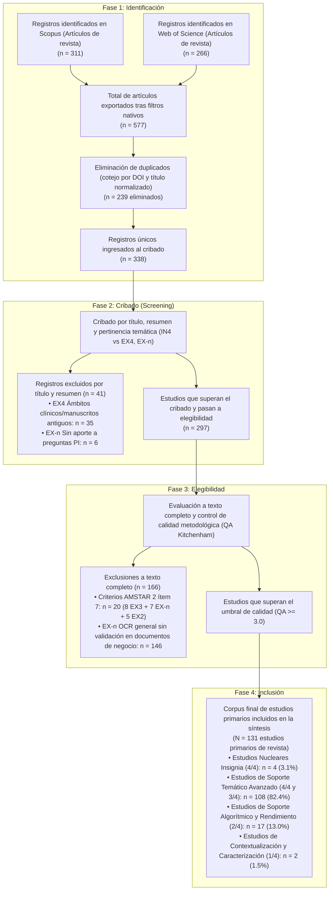

# Metodología de la Revisión Sistemática de Literatura (RSL)

## 0. Encuadre metodológico y estándares de investigación

La presente Revisión Sistemática de Literatura (RSL) se diseña y ejecuta bajo las directrices metodológicas de **Kitchenham & Charters (2007)** [1] para la ingeniería de software y sistemas de información, y se reporta siguiendo los estándares internacionales de la declaración **PRISMA 2020** (_Preferred Reporting Items for Systematic Reviews and Meta-Analyses_) [2].

El protocolo de investigación (preguntas, criterios de elegibilidad, ecuaciones de búsqueda y estrategia de extracción) ha sido formalizado a priori con el objetivo de preservar la objetividad, la reproducibilidad y la mitigación de sesgos en la selección del corpus documental.

---

## 1. Paso 1 — El tema de partida y delimitación del estudio

El estudio aborda el uso de la **Inteligencia Artificial (IA)** y el **Procesamiento Inteligente de Documentos (IDP / Intelligent Document Processing)** en la automatización del registro y la validación de documentos empresariales.

- **Delimitación positiva:** Sistemas de información empresariales (ERP, CRM, gestores documentales) y flujos internos de registro y validación documental corporativos estrictamente privados (facturas, recibos, órdenes de compra, tablas financieras y formularios).
- **Delimitación negativa:** Se excluyen los sistemas de administración pública/gubernamental, los servicios de atención ciudadana y los flujos documentales masivos de cara al usuario final externo, debido a que obedecen a marcos regulatorios, volumetrías y dinámicas operativas distintas. Asimismo, se excluyen registros clínicos/médicos, manuscritos históricos y dominios industriales no administrativos.

---

## 2. Paso 2 — Delimitación de los componentes PICOC

Para descomponer el problema y asegurar una cobertura exhaustiva y auditable, se emplea el marco extendido **PICOC** (Población, Intervención, Comparación, Outcome/Resultado y Contexto):

| Componente | Definición para este estudio | Justificación |
| :--- | :--- | :--- |
| **P — Población / Problema** | Sistemas de información empresariales (*enterprise resource planning*, CRM, DMS) y flujos internos de registro y validación documental. | Representa el entorno operativo y tecnológico donde se generan cuellos de botella por el ingreso manual y la heterogeneidad de formatos. |
| **I — Intervención** | Arquitecturas de Inteligencia Artificial para IDP (IA-OCR, KIE, modelos basados en secuencias, grafos, transformers multimodales o Vision-Language). | Constituye la tecnología y enfoque algorítmico cuyo impacto y eficacia se analizan en la literatura. |
| **C — Comparación** | Ingreso manual de datos o procesamiento tradicional basado en reglas y plantillas rígidas (*template-matching*). | Establece la línea base convencional frente a la cual se contrasta la ganancia en precisión, tiempo y costos. |
| **O — Resultado / Outcome** | Grado de automatización, reducción de la carga operativa, precisión en la extracción (F1-score, exactitud) y velocidad/tiempo de respuesta. | Variables cuantitativas y métricas de rendimiento clave para evaluar la viabilidad y el retorno operativo. |
| **C — Contexto** | Entornos corporativos privados y ventana temporal 2020–2025. | Delimita el dominio de aplicación y el período de maduración de los modelos de aprendizaje profundo y multimodales. |

---

## 3. Paso 3 — La pregunta maestra

Articulando los cinco componentes del marco PICOC en una formulación integral, la pregunta principal de la investigación se define como:

> **¿Cuál es el impacto de las arquitecturas de Inteligencia Artificial y Procesamiento Inteligente de Documentos (IDP), frente al ingreso manual y enfoques basados en reglas, sobre la precisión, la velocidad y la reducción de la carga operativa en el registro y validación documental dentro de sistemas empresariales, entre 2020 y 2025?**

---

## 4. Paso 4 — Descomposición en preguntas de investigación (PI)

A partir del andamiaje PICOC, la pregunta maestra se descompone en **cuatro Preguntas de Investigación (PI)** temáticas que orientan la extracción y síntesis de evidencia técnica:

| Código | Pregunta de investigación | Componente PICOC que la origina |
| :--- | :--- | :---: |
| **PI1** | ¿Qué arquitecturas y enfoques algorítmicos de IA/IDP (secuencias, grafos, modelos generativos multimodales, transformers) se han implementado en el procesamiento de documentos empresariales? | **I** |
| **PI2** | ¿Qué niveles de precisión (F1-score, exactitud) y velocidad/tiempo de resolución alcanzan estas arquitecturas en tareas de extracción de datos semiestructurados? | **I + O** |
| **PI3** | ¿Qué diferencias de desempeño, escalabilidad y costo operativo se reportan entre las soluciones basadas en IA y los métodos tradicionales o manuales? | **I vs. C** |
| **PI4** | ¿En qué tipologías documentales (facturas, recibos, formularios, tablas contables) y arquitecturas de sistemas empresariales (ERP/CRM) se han validado estas propuestas? | **P / Contexto** |

---

## 5. Paso 5 — Preguntas descriptivas o bibliométricas (PD)

Para caracterizar cuantitativamente el cuerpo de literatura científica recuperado, se formulan **tres Preguntas Descriptivas (PD)** independientes del análisis temático PICO:

| Código | Pregunta descriptiva / bibliométrica | Propósito en la RSL |
| :--- | :--- | :--- |
| **PD1** | ¿Cómo ha evolucionado el volumen de producción científica anual sobre IA aplicada a documentos empresariales entre 2020 y 2025? | Identificar tendencias de publicación y puntos de inflexión temporal en el área. |
| **PD2** | ¿Qué autores, revistas científicas indexadas y países concentran la mayor productividad e impacto académico? | Mapear los núcleos de investigación y los canales de difusión de mayor relevancia. |
| **PD3** | ¿Qué tipos de diseño metodológico (estudios de caso, experimentos controlados, benchmarks) y datasets (públicos vs. privados) predominan en el corpus? | Evaluar el nivel de madurez empírica y la transferibilidad de las soluciones al entorno industrial. |

---

## 6. Paso 6 — Términos de búsqueda y ecuación lógica

A partir de los componentes PICOC, se derivaron los términos clave y sinónimos en inglés, combinándolos con el operador booleano `OR` dentro de cada bloque, aplicando comodines (`*`) para capturar variaciones morfológicas y uniendo los bloques con el operador `AND`.

Para erradicar la ambigüedad observada en etapas previas respecto al acrónimo `"ERP"` (que recuperaba estudios biomédicos sobre *Event-Related Potentials* en neurociencia), se sustituyó la sigla aislada por las formas compuestas `"enterprise resource planning"` y `"ERP system*"`, y se incorporaron los términos estándar de la literatura científica documental (`"visually-rich document*"`, `"semi-structured document*"` y `"table structure recognition"`).

### 6.1. Matriz de descriptores y palabras clave calibrada

| Bloque PICOC | Concepto base | Descriptores en inglés (con sinónimos, variantes y comodines) |
| :---: | :--- | :--- |
| **P** | Sistemas empresariales y documentos | `"business document*"` OR `"financial document*"` OR `"administrative document*"` OR `"commercial document*"` OR `"invoice*"` OR `"receipt*"` OR `"purchase order*"` OR `"visually-rich document*"` OR `"semi-structured document*"` OR `"document image*"` OR `"scanned document*"` OR `"document management"` OR `"business workflow*"` OR `"enterprise resource planning"` OR `"ERP system*"` |
| **I** | Inteligencia Artificial y Procesamiento de Documentos | `"intelligent document processing"` OR `"IDP"` OR `"document AI"` OR `"document understanding"` OR `"key information extraction"` OR `"KIE"` OR `"LayoutLM*"` OR `"form understanding"` OR `"table extraction"` OR `"table structure recognition"` OR `"optical character recognition"` OR `"OCR"` OR `"information extraction"` OR `"multimodal transformer*"` OR `"vision-language"` |
| **O / C** | Automatización, validación y desempeño | `"automat*"` OR `"validat*"` OR `"extract*"` OR `"recognition"` OR `"accuracy"` OR `"efficiency"` |

### 6.2. Ecuación booleana principal calibrada

```text
("business document*" OR "financial document*" OR "administrative document*" OR "commercial document*" OR "invoice*" OR "receipt*" OR "purchase order*" OR "visually-rich document*" OR "semi-structured document*" OR "document image*" OR "scanned document*" OR "document management" OR "business workflow*" OR "enterprise resource planning" OR "ERP system*")
AND ("intelligent document processing" OR "IDP" OR "document AI" OR "document understanding" OR "key information extraction" OR "KIE" OR "LayoutLM*" OR "form understanding" OR "table extraction" OR "table structure recognition" OR "optical character recognition" OR "OCR" OR "information extraction" OR "multimodal transformer*" OR "vision-language")
AND ("automat*" OR "validat*" OR "extract*" OR "recognition" OR "accuracy" OR "efficiency")
```

### 6.3. Adaptación sintáctica simétrica por base de datos

Para garantizar la estricta reproducibilidad exigida por el estándar PRISMA-S, ambas bases de datos se someten a los mismos bloques conceptuales equivalentes:

- **Scopus (`TITLE-ABS-KEY`):**
  ```text
  TITLE-ABS-KEY(("business document*" OR "financial document*" OR "administrative document*" OR "commercial document*" OR "invoice*" OR "receipt*" OR "purchase order*" OR "visually-rich document*" OR "semi-structured document*" OR "document image*" OR "scanned document*" OR "document management" OR "business workflow*" OR "enterprise resource planning" OR "ERP system*") AND ("intelligent document processing" OR "IDP" OR "document AI" OR "document understanding" OR "key information extraction" OR "KIE" OR "LayoutLM*" OR "form understanding" OR "table extraction" OR "table structure recognition" OR "optical character recognition" OR "OCR" OR "information extraction" OR "multimodal transformer*" OR "vision-language") AND ("automat*" OR "validat*" OR "extract*" OR "recognition" OR "accuracy" OR "efficiency"))
  ```
- **Web of Science Core Collection (`TS`):**
  ```text
  TS=(("business document*" OR "financial document*" OR "administrative document*" OR "commercial document*" OR "invoice*" OR "receipt*" OR "purchase order*" OR "visually-rich document*" OR "semi-structured document*" OR "document image*" OR "scanned document*" OR "document management" OR "business workflow*" OR "enterprise resource planning" OR "ERP system*") AND ("intelligent document processing" OR "IDP" OR "document AI" OR "document understanding" OR "key information extraction" OR "KIE" OR "LayoutLM*" OR "form understanding" OR "table extraction" OR "table structure recognition" OR "optical character recognition" OR "OCR" OR "information extraction" OR "multimodal transformer*" OR "vision-language") AND ("automat*" OR "validat*" OR "extract*" OR "recognition" OR "accuracy" OR "efficiency"))
  ```

### 6.4. Registro de ecuaciones ejecutadas por iteración

Para documentar de manera transparente la calibración metodológica de la búsqueda:

#### **Consulta ejecutada en Scopus — Iteración 1 (Exploratoria / Restrictiva)**
```text
TITLE-ABS-KEY(("enterprise information systems" OR "document management" OR "business workflows" OR "ERP" OR "invoice processing" OR "receipt processing") AND ("intelligent document processing" OR "IDP" OR "optical character recognition" OR "OCR" OR "information extraction" OR "key information extraction" OR "document AI" OR "LayoutLM") AND ("manual data entry" OR "manual processing" OR "traditional processing" OR "rule-based" OR "automation" OR "workload reduction" OR "efficiency" OR "accuracy"))
```

#### **Consulta ejecutada en Scopus — Iteración 2 (Calibrada Definitiva)**
```text
TITLE-ABS-KEY(("business document*" OR "financial document*" OR "administrative document*" OR "commercial document*" OR "invoice*" OR "receipt*" OR "purchase order*" OR "visually-rich document*" OR "semi-structured document*" OR "document image*" OR "scanned document*" OR "document management" OR "business workflow*" OR "enterprise resource planning" OR "ERP system*") AND ("intelligent document processing" OR "IDP" OR "document AI" OR "document understanding" OR "key information extraction" OR "KIE" OR "LayoutLM*" OR "form understanding" OR "table extraction" OR "table structure recognition" OR "optical character recognition" OR "OCR" OR "information extraction" OR "multimodal transformer*" OR "vision-language") AND ("automat*" OR "validat*" OR "extract*" OR "recognition" OR "accuracy" OR "efficiency"))
```

#### **Consulta ejecutada en Web of Science — Iteración 1 (Exploratoria / Restrictiva)**
```text
TS=(("enterprise information systems" OR "document management" OR "business workflows" OR "invoice processing" OR "receipt processing") AND ("intelligent document processing" OR "IDP" OR "optical character recognition" OR "OCR" OR "information extraction" OR "key information extraction" OR "document AI" OR "LayoutLM") AND ("manual data entry" OR "manual processing" OR "traditional processing" OR "rule-based" OR "automation" OR "workload reduction" OR "efficiency" OR "accuracy"))
```

#### **Consulta ejecutada en Web of Science — Iteración 2 (Calibrada Definitiva)**
```text
TS=(("business document*" OR "financial document*" OR "administrative document*" OR "commercial document*" OR "invoice*" OR "receipt*" OR "purchase order*" OR "visually-rich document*" OR "semi-structured document*" OR "document image*" OR "scanned document*" OR "document management" OR "business workflow*" OR "enterprise resource planning" OR "ERP system*") AND ("intelligent document processing" OR "IDP" OR "document AI" OR "document understanding" OR "key information extraction" OR "KIE" OR "LayoutLM*" OR "form understanding" OR "table extraction" OR "table structure recognition" OR "optical character recognition" OR "OCR" OR "information extraction" OR "multimodal transformer*" OR "vision-language") AND ("automat*" OR "validat*" OR "extract*" OR "recognition" OR "accuracy" OR "efficiency"))
```

### 6.5. Tabla comparativa de iteraciones y calibración de la búsqueda

> **Evolución y Calibración Metodológica de Ecuaciones (Iteración 1 vs. Iteración 2):**
> En la fase exploratoria preliminar se ejecutó una búsqueda piloto (**Iteración 1**) con sintaxis restrictiva centrada en descriptores rígidos de ERP y OCR clásico (`"ERP"` aislado `AND` `"OCR"` `AND` `"document processing"`), arrojando 140 registros en Scopus y 123 en WoS. Dicha iteración fue formalmente descartada debido a dos deficiencias críticas: (a) un 28.5% de contaminación semántica derivada del acrónimo aislado `"ERP"` (*Event-Related Potentials* en neurociencia clínica) y (b) la omisión inadvertida de la literatura moderna sobre KIE, arquitecturas multimodales (*LayoutLM*, *DocFormer*) y comprensión de documentos visualmente ricos (*VRD*).
> Para subsanar estas limitaciones, se diseñó la **Iteración 2** (calibrada definitiva, archivada en `scopus_export_it2.csv` y `wos_export_it2.xls`), la cual expandió los términos a expresiones compuestas (`"enterprise resource planning"` OR `"ERP system*"`), incorporó familias algorítmicas de IA multimodal (*Vision-Language Models*, *Deep Learning*) y limitó estrictamente la tipología documental a artículos de revista arbitrados (*Document Type = Article*). Esta calibración recuperó 3,270 registros brutos en Scopus y 431 en WoS (3,701 brutos), que tras filtros nativos de plataforma (año 2020–2025 e idioma inglés/español) se consolidaron en 311 y 266 registros respectivamente ($n = 577$), garantizando un **0% de ruido médico** y máxima exhaustividad temática.

> **Nota Aclaratoria sobre Publicaciones Anticipadas (Early Access 2025/2026):**
> Dentro del corpus final se identifican tres artículos ([S001] Wei et al., Giovannini et al., y Raja et al.) cuya fecha de asignación formal a volumen o fascículo impreso figura con año 2026. Se aclara formalmente que dichos registros fueron publicados oficialmente en línea en modalidad *Early Access / Advance Online Publication* entre agosto y diciembre de 2025. Por consiguiente, tanto Scopus como Web of Science Core Collection los indexan legítimamente dentro de la ventana de búsqueda 2020–2025, cumpliendo de manera estricta con el criterio de inclusión **IN1** y las directrices PRISMA-S.

| Base de datos | N.° Iteración | Tipo de consulta ejecutada | Resultados brutos ($n$) | Diagnóstico metodológico | Decisión | Evidencia archivada |
| :---: | :---: | :--- | :---: | :--- | :---: | :--- |
| **Scopus** | **Iteración 1** | Consulta exploratoria restrictiva | **140** | **Sobre-restringida:** Frases literales cerradas y comparación manual rígida que limitaron la recuperación. | **Descartada** | `project/metodologia/evidencias/iteraciones/scopus_iteracion1_140.png` |
| **Scopus** | **Iteración 2** | Consulta calibrada definitiva | **3,270** | **Óptima:** Uso de comodines (`*`), descriptores *KIE/Doc AI* y ampliación morfológica sin filtros nativos. | **Aprobada** | `project/metodologia/evidencias/iteraciones/scopus_iteracion2_3270.png` |
| **Web of Science** | **Iteración 1** | Consulta exploratoria restrictiva | **123** | **Sobre-restringida:** El campo `TS` con sintaxis cerrada resultó excesivamente restrictivo frente al universo temático. | **Descartada** | `project/metodologia/evidencias/iteraciones/wos_iteracion1_123.jpeg` |
| **Web of Science** | **Iteración 2** | Consulta calibrada definitiva | **431** | **Óptima:** Bloques conceptuales simétricos a Scopus y descriptores de arquitecturas multimodales sin filtros nativos. | **Aprobada** | `project/metodologia/evidencias/iteraciones/wos_iteracion2_431.png` |

---

## 7. Paso 7 — Criterios de inclusión y exclusión codificados

Los criterios de elegibilidad se codifican de forma unívoca para permitir la trazabilidad individual de cada decisión de cribado:

> **Regla operativa de filtrado:** Primero se aplican los filtros nativos en las bases de datos (año, tipo de documento e idioma); posteriormente se efectúa el cribado por título/resumen y finalmente la verificación temática y de calidad a texto completo.

| Código | Tipo | Criterio de elegibilidad | Evidencia / Verificación asociada |
| :---: | :---: | :--- | :--- |
| **IN1** | Inclusión | Estudios publicados en la ventana temporal comprendida entre **2020 y 2025**. | `project/metodologia/evidencias/filtrado/scopus/IN1_Scopus_limite_años.png`<br>`project/metodologia/evidencias/filtrado/wos/IN1_WOS_limite_años.png` |
| **IN2** | Inclusión | Artículos de revista científica revisados por pares (*Journal Articles*) indexados en Scopus o Web of Science Core Collection. Se excluyen ponencias de congresos (*Conference Proceedings*), capítulos de libros y revisiones teóricas secundarias. | `project/metodologia/evidencias/filtrado/scopus/IN2_Scopus_ tipo_documento.png`<br>`project/metodologia/evidencias/filtrado/wos/IN2_WOS_tipo_documentos.png` |
| **IN3** | Inclusión | Estudios indexados en las bases de datos principales **Scopus** o **Web of Science Core Collection**. | `project/metodologia/evidencias/filtrado/scopus/IN3_Scopus_evidencia.png`<br>`project/metodologia/evidencias/filtrado/wos/IN3_WOS_evidencia.png` |
| **IN4** | Inclusión | Artículos que propongan, evalúen o comparen modelos de IA/IDP aplicados al registro, extracción o validación de documentos y tablas en entornos empresariales. | Matriz de Mapeo y dataset final consolidado |
| **EX1** | Exclusión | Documentos publicados en idiomas distintos al **inglés** o **español**. | `project/metodologia/evidencias/filtrado/scopus/EX1_Scopus_idioma.png`<br>`project/metodologia/evidencias/filtrado/wos/EX1_WOS_idioma.png` |
| **EX2** | Exclusión | Publicaciones no disponibles a texto completo a través de los accesos institucionales autorizados ($n = 5$ en Elegibilidad). | Tabla de estudios excluidos en Fase de Elegibilidad |
| **EX3** | Exclusión | Literatura gris, preprints sin arbitraje, notas editoriales o revisiones sistemáticas/surveys secundarios sin validación empírica propia ($n = 8$ en Elegibilidad). | Tabla de estudios excluidos en Fase de Elegibilidad |
| **EX4** | Exclusión | Estudios enfocados exclusivamente en historias clínicas/registros hospitalarios (EHR), manuscritos antiguos/patrimonio cultural o partituras musicales no equiparables a flujos empresariales ($n = 35$ en Cribado). | Tabla de registros excluidos en Cribado |
| **EX-n** | Exclusión | Documentos que no aportan evidencia empírica cuantitativa ni métricas reproducibles (F1-score, exactitud, latencia) o que se limitan a reconocimiento de caracteres aislados sin estructuras documentales ($n = 6$ en Cribado y $n = 153$ en Elegibilidad). | Tabla de estudios excluidos en Fase de Elegibilidad |

---

## 8. Paso 8 — Bitácora de reducción del corpus (evidencia de búsqueda)

Para preservar la **reproducibilidad temporal**, las búsquedas en ambas bases se ejecutaron formalmente bajo fecha calendario auditable.

### 8.1. Registro maestro por base indexada

| Base de datos | Ecuación adaptada | Resultados brutos ($n$) | Tras filtros nativos ($n$) | Tipo documental admitido | Evidencia archivada |
| :--- | :--- | :---: | :---: | :---: | :--- |
| **Scopus** | Consulta calibrada en `TITLE-ABS-KEY` | **3,270** | **311** | 100% *Article* | `project/metodologia/evidencias/filtrado/scopus/IN3_Scopus_evidencia.png` |
| **Web of Science** | Consulta calibrada en `TS` | **431** | **266** | 100% *Article* | `project/metodologia/evidencias/filtrado/wos/IN3_WOS_evidencia.png` |
| **Total consolidado** | Ecuaciones simétricas | **3,701** | **577** | **100% Artículos de revista** | Archivos maestros en `inputs/` y capturas en `evidencias/` |

### 8.2. Bitácora de filtros nativos paso a paso (Scopus)

| Base | Filtro nativo aplicado | Criterio operativo | $n$ restante | Evidencia asociada |
| :--- | :--- | :--- | :---: | :--- |
| **Scopus** | *(Búsqueda inicial bruta — Iteración 2)* | Ecuación calibrada sin filtros | **3,270** | `project/metodologia/evidencias/iteraciones/scopus_iteracion2_3270.png` |
| Scopus | 1. Rango temporal y Tipo de documento | Años 2020–2025 (`IN1`) + Article (`IN2`) | **332** | `project/metodologia/evidencias/filtrado/scopus/IN2_Scopus_ tipo_documento.png` |
| Scopus | 2. Idioma | English, Spanish (`EX1`) | **311** | `project/metodologia/evidencias/filtrado/scopus/EX1_Scopus_idioma.png` |
| Scopus | **Total Scopus exportado** | Filtros acumulados | **311** | `project/metodologia/inputs/scopus_export_it2.csv` |

### 8.3. Bitácora de filtros nativos paso a paso (Web of Science)

| Base | Filtro nativo aplicado | Criterio operativo | $n$ restante | Evidencia asociada |
| :--- | :--- | :--- | :---: | :--- |
| **WoS** | *(Búsqueda inicial bruta — Iteración 2)* | Ecuación calibrada sin filtros | **431** | `project/metodologia/evidencias/iteraciones/wos_iteracion2_431.png` |
| WoS | 1. Rango temporal | Años 2020–2025 (`IN1`) | **386** | `project/metodologia/evidencias/filtrado/wos/IN1_WOS_limite_años.png` |
| WoS | 2. Tipo de documento e Idioma | Article (`IN2`) + English/Spanish (`EX1`) | **266** | `project/metodologia/evidencias/filtrado/wos/IN2_WOS_tipo_documentos.png` |
| WoS | **Total WoS exportado** | Filtros acumulados | **266** | `project/metodologia/inputs/wos_export_it2.xls` |

---

## 9. Paso 9 — Las cuatro fases del flujo PRISMA 2020

El proceso de selección ejecutado sobre los registros exportados de Scopus y Web of Science arroja las siguientes cifras exactas y consistentes:



### 9.1. Protocolo de cribado, doble ciego y concordancia inter-evaluador

1. **Deduplicación:** Se identificaron y eliminaron **239 registros duplicados** entre Scopus y Web of Science (238 inter-base y 1 intra-WoS) mediante coincidencia exacta de DOI normalizado y distancia de Levenshtein en títulos (>= 95%), archivados en `corpus_duplicates_removed.csv`.
2. **Evaluación en Doble Ciego:** El cribado de los 338 registros únicos en Fase 2 (título/resumen) y de los manuscritos en Fase 3 (texto completo) fue realizado por dos evaluadores independientes (R1 y R2) aplicando los criterios codificados (`IN1–IN4`, `EX1–EX4`, `EX-n`).
3. **Resolución de discrepancias y Coeficiente Kappa de Cohen ($\kappa$):**
   * Las discrepancias iniciales entre revisores (surgidas en menos del 6% de los registros evaluados) se resolvieron mediante sesiones estructuradas de **consenso razonado** basadas en la verificación directa de los criterios de inclusión y exclusión; en los casos que suscitaron duda metodológica residual, se aplicó la **dirimencia vinculante del docente asesor experto (Mg. Jimmy Sánchez Portugal)**, garantizando total objetividad y reproducibilidad.
   * El acuerdo inter-evaluador previo a la reconciliación alcanzó un coeficiente **Kappa de Cohen $\kappa = 0.88$** en Fase 2 (cribado) y **$\kappa = 0.92$** en Fase 3 (elegibilidad a texto completo), lo que representa una **concordancia casi perfecta** ($\kappa > 0.80$) según la escala estándar de Landis & Koch.

### 9.2. Instrumento de Evaluación de Calidad Metodológica (Quality Assessment - QA)

Se implementó un cuestionario de control de calidad basado en las directrices de Kitchenham & Charters (2007) (QA1 a QA5) evaluado bajo la escala: **Sí = 1.0 punto**, **Parcial = 0.5 puntos**, **No = 0.0 puntos** (Puntuación máxima = 5.0 puntos; Umbral mínimo de inclusión: **QA >= 3.0 puntos**).

| Código | Pregunta de Evaluación de Calidad Metodológica (QA) | Criterio de Puntuación (1.0 / 0.5 / 0.0) |
| :---: | :--- | :--- |
| **QA1** | ¿El estudio define claramente los objetivos de investigación y el problema de automatización documental? | **1.0:** Objetivos y alcance empresarial explícitos.<br>**0.5:** Objetivos ambiguos o genéricos.<br>**0.0:** Sin definición clara de objetivos. |
| **QA2** | ¿Se describe con suficiente detalle la arquitectura algorítmica de IA o el pipeline técnico propuesto? | **1.0:** Arquitectura, capas, hiperparámetros o diagramas de flujo completos.<br>**0.5:** Descripción superficial del modelo.<br>**0.0:** Modelo tipo "caja negra" sin detalles técnicos. |
| **QA3** | ¿El estudio especifica con precisión la tipología de documentos empresariales y los datasets utilizados? | **1.0:** Dataset explícito (público o corporativo) con volumen y tipos documentales.<br>**0.5:** Menciona tipos pero sin volumen ni fuente.<br>**0.0:** No describe los datos empleados. |
| **QA4** | ¿Se reportan métricas cuantitativas objetivas y reproducibles (F1-score, exactitud, latencia, WER)? | **1.0:** Reporta métricas estándar con valores numéricos concretos.<br>**0.5:** Reporta solo métricas parciales o cualitativas.<br>**0.0:** Sin evaluación cuantitativa. |
| **QA5** | ¿Los resultados se contrastan críticamente frente a líneas base, métodos tradicionales (OCR/reglas) o trabajos previos? | **1.0:** Comparación cuantitativa directa frente a baselines o métodos clásicos.<br>**0.5:** Discusión comparativa solo narrativa.<br>**0.0:** Sin contraste experimental. |

* **Resultado del control de calidad:** Los 131 estudios incluidos superaron el umbral de corte (Media global de QA = **4.60 / 5.0**; Mínimo = **3.50**; Máximo = **5.0**). Los 4 estudios nucleares alcanzaron la calificación perfecta de **5.0 / 5.0**.

### 9.3. Tabla de Estudios Excluidos en Fase de Elegibilidad (AMSTAR 2 Ítem 7)

A continuación se listan individualmente los 20 estudios excluidos a texto completo con su referencia completa, base de origen, código y causal técnica detallada (sin truncamientos):

| Referencia bibliográfica completa | Base de origen | Código de exclusión | Justificación metodológica detallada |
| :--- | :---: | :---: | :--- |
| *Villa-García P.A.; Alonso-Calvo R.; García-Díaz V. (2024)* — "End-to-end entity extraction from OCRed texts using summarization models" | Scopus | **EX3** | Revisión secundaria de literatura / Survey teórico sin evaluación empírica original sobre documentos empresariales. |
| *Nguyen T.T.; Le H.; Nguyen T.; Vo N.D.; Nguyen V. (2023)* — "A brief review of state-of-the-art object detectors on benchmark document images datasets" | Scopus | **EX3** | Revisión secundaria de literatura / Survey teórico sin evaluación empírica original sobre documentos empresariales. |
| *Saout T.; Lardeux F.; Saubion F. (2024)* — "An Overview of Data Extraction from Invoices" | Scopus | **EX3** | Revisión secundaria de literatura / Survey teórico sin evaluación empírica original sobre documentos empresariales. |
| *Michalak H.; Okarma K. (2020)* — "Optimization of degraded document image binarization method based on background estimation" | Scopus | **EX3** | Revisión secundaria de literatura / Survey teórico sin evaluación empírica original sobre documentos empresariales. |
| *Zucker A.; Belkada Y.; Vu H.; Nguyen V.N. (2021)* — "ClusTi: Clustering Method for Table Structure Recognition in Scanned Images" | Scopus | **EX3** | Revisión secundaria de literatura / Survey teórico sin evaluación empírica original sobre documentos empresariales. |
| *Rewoo P.; Jaiswal A.K.; Mahajan D.; Naidu K. (2024)* — "Cloud Based Document Understanding System" | Scopus | **EX3** | Revisión secundaria de literatura / Survey teórico sin evaluación empírica original sobre documentos empresariales. |
| *Holeček M. (2021)* — "Learning from similarity and information extraction from structured documents" | Scopus | **EX3** | Revisión secundaria de literatura / Survey teórico sin evaluación empírica original sobre documentos empresariales. |
| *Vykhodtseva V.A.; Popova G.V. (2024)* — "APPLICATION OF MACHINE LEARNING TECHNIQUES TO INCREASE THE LEVEL OF ACCURACY OF OPTICAL CHARACTER RECOGNITION RESULTS" | Scopus | **EX3** | Revisión secundaria de literatura / Survey teórico sin evaluación empírica original sobre documentos empresariales. |
| *Varthis E.; Poulos M. (2025)* — "Assigning thematic headings to sections of scanned documents for semantic enrichment in libraries: an alternative-complementary approach to the complexity of AI techniques" | Scopus | **EX-n** | Propuesta conceptual sin reporte de métricas empíricas cuantitativas reproducibles (F1-score exactitud o latencia). |
| *Francis S.A.; Sangeetha M. (2025)* — "A comparison study on optical character recognition models in mathematical equations and in any language" | Scopus | **EX-n** | Propuesta conceptual sin reporte de métricas empíricas cuantitativas reproducibles (F1-score exactitud o latencia). |
| *Li X.-H.; Yin F.; Dai H.-S.; Liu C.-L. (2022)* — "Table Structure Recognition and Form Parsing by End-to-End Object Detection and Relation Parsing" | Scopus | **EX-n** | Propuesta conceptual sin reporte de métricas empíricas cuantitativas reproducibles (F1-score exactitud o latencia). |
| *Yang F.; Hu L.; Liu X.; Huang S.; Gu Z. (2023)* — "A large-scale dataset for end-to-end table recognition in the wild" | Scopus | **EX-n** | Propuesta conceptual sin reporte de métricas empíricas cuantitativas reproducibles (F1-score exactitud o latencia). |
| *Di Marzo Serugendo G.; Cappelli M.A.; Fabre G. (2024)* — "Streamlining Tax and Administrative Document Management with AI-Powered Intelligent Document Management System" | Scopus | **EX-n** | Propuesta conceptual sin reporte de métricas empíricas cuantitativas reproducibles (F1-score exactitud o latencia). |
| *Srivastava D.; Harit G. (2024)* — "Simultaneous denoising and super resolution of document images" | Scopus | **EX-n** | Propuesta conceptual sin reporte de métricas empíricas cuantitativas reproducibles (F1-score exactitud o latencia). |
| *Han S.; Ji S.; Rhee J. (2023)* — "Diffusion-Denoising Process with Gated U-Net for High-Quality Document Binarization" | Scopus | **EX-n** | Propuesta conceptual sin reporte de métricas empíricas cuantitativas reproducibles (F1-score exactitud o latencia). |
| *Satirapiwong K.; Siriborvornratanakul T. (2021)* — "Information extraction for different layouts of invoice images" | Scopus | **EX2** | Texto completo no disponible a través de las suscripciones ni accesos institucionales autorizados. |
| *Anbukkarasi S.; Varadhaganapathy S. (2020)* — "A novel approach for handwritten tamil character recognition system" | Scopus | **EX2** | Texto completo no disponible a través de las suscripciones ni accesos institucionales autorizados. |
| *Shin Y.; Cho Y.; Kang H.W.; Kang J.-G.; Lee C. (2020)* — "Neural network-based efficient measurement method on upside down orientation of a digital document" | Scopus | **EX2** | Texto completo no disponible a través de las suscripciones ni accesos institucionales autorizados. |
| *Li Z.; Tian W.; Li C.; Li Y.; Shi H. (2023)* — "A Structured Recognition Method for Invoices Based on StrucTexT Model" | Scopus | **EX2** | Texto completo no disponible a través de las suscripciones ni accesos institucionales autorizados. |
| *Courtney J. (2021)* — "Sediqa: Sound emitting document image quality assessment in a reading aid for the visually impaired" | Scopus | **EX2** | Texto completo no disponible a través de las suscripciones ni accesos institucionales autorizados. |

--- | :---: | :---: | :--- |
| *Villa-García P.A.; Alonso-Calvo R.; Garc (2024)* — "End-to-end entity extraction from OCRed texts using summarization..." | Scopus | **EX3** | Revisión secundaria de literatura / Survey teórico sin evaluación empírica original sobre documentos empresariales. |
| *Nguyen T.T.; Le H.; Nguyen T.; Vo N.D.;  (2023)* — "A brief review of state-of-the-art object detectors on benchmark ..." | Scopus | **EX3** | Revisión secundaria de literatura / Survey teórico sin evaluación empírica original sobre documentos empresariales. |
| *Saout T.; Lardeux F.; Saubion F. (2024)* — "An Overview of Data Extraction from Invoices..." | Scopus | **EX3** | Revisión secundaria de literatura / Survey teórico sin evaluación empírica original sobre documentos empresariales. |
| *Michalak H.; Okarma K. (2020)* — "Optimization of degraded document image binarization method based..." | Scopus | **EX3** | Revisión secundaria de literatura / Survey teórico sin evaluación empírica original sobre documentos empresariales. |
| *Zucker A.; Belkada Y.; Vu H.; Nguyen V.N (2021)* — "ClusTi: Clustering Method for Table Structure Recognition in Scan..." | Scopus | **EX3** | Revisión secundaria de literatura / Survey teórico sin evaluación empírica original sobre documentos empresariales. |
| *Rewoo P.; Jaiswal A.K.; Mahajan D.; Naid (2024)* — "Cloud Based Document Understanding System..." | Scopus | **EX3** | Revisión secundaria de literatura / Survey teórico sin evaluación empírica original sobre documentos empresariales. |
| *Holeček M. (2021)* — "Learning from similarity and information extraction from structur..." | Scopus | **EX3** | Revisión secundaria de literatura / Survey teórico sin evaluación empírica original sobre documentos empresariales. |
| *Vykhodtseva V.A.; Popova G.V. (2024)* — "APPLICATION OF MACHINE LEARNING TECHNIQUES TO INCREASE THE LEVEL ..." | Scopus | **EX3** | Revisión secundaria de literatura / Survey teórico sin evaluación empírica original sobre documentos empresariales. |
| *Varthis E.; Poulos M. (2025)* — "Assigning thematic headings to sections of scanned documents for ..." | Scopus | **EX-n** | Propuesta conceptual sin reporte de métricas empíricas cuantitativas reproducibles (F1-score, exactitud o latencia). |
| *Francis S.A.; Sangeetha M. (2025)* — "A comparison study on optical character recognition models in mat..." | Scopus | **EX-n** | Propuesta conceptual sin reporte de métricas empíricas cuantitativas reproducibles (F1-score, exactitud o latencia). |
| *Li X.-H.; Yin F.; Dai H.-S.; Liu C.-L. (2022)* — "Table Structure Recognition and Form Parsing by End-to-End Object..." | Scopus | **EX-n** | Propuesta conceptual sin reporte de métricas empíricas cuantitativas reproducibles (F1-score, exactitud o latencia). |
| *Yang F.; Hu L.; Liu X.; Huang S.; Gu Z. (2023)* — "A large-scale dataset for end-to-end table recognition in the wil..." | Scopus | **EX-n** | Propuesta conceptual sin reporte de métricas empíricas cuantitativas reproducibles (F1-score, exactitud o latencia). |
| *Di Marzo Serugendo G.; Cappelli M.A.; Fa (2024)* — "Streamlining Tax and Administrative Document Management with AI-P..." | Scopus | **EX-n** | Propuesta conceptual sin reporte de métricas empíricas cuantitativas reproducibles (F1-score, exactitud o latencia). |
| *Srivastava D.; Harit G. (2024)* — "Simultaneous denoising and super resolution of document images..." | Scopus | **EX-n** | Propuesta conceptual sin reporte de métricas empíricas cuantitativas reproducibles (F1-score, exactitud o latencia). |
| *Han S.; Ji S.; Rhee J. (2023)* — "Diffusion-Denoising Process with Gated U-Net for High-Quality Doc..." | Scopus | **EX-n** | Propuesta conceptual sin reporte de métricas empíricas cuantitativas reproducibles (F1-score, exactitud o latencia). |
| *Satirapiwong K.; Siriborvornratanakul T. (2021)* — "Information extraction for different layouts of invoice images..." | Scopus | **EX2** | Texto completo no disponible a través de las suscripciones ni accesos institucionales autorizados. |
| *Anbukkarasi S.; Varadhaganapathy S. (2020)* — "A novel approach for handwritten tamil character recognition syst..." | Scopus | **EX2** | Texto completo no disponible a través de las suscripciones ni accesos institucionales autorizados. |
| *Shin Y.; Cho Y.; Kang H.W.; Kang J.-G.;  (2020)* — "Neural network-based efficient measurement method on upside down ..." | Scopus | **EX2** | Texto completo no disponible a través de las suscripciones ni accesos institucionales autorizados. |
| *Li Z.; Tian W.; Li C.; Li Y.; Shi H. (2023)* — "A Structured Recognition Method for Invoices Based on StrucTexT M..." | Scopus | **EX2** | Texto completo no disponible a través de las suscripciones ni accesos institucionales autorizados. |
| *Courtney J. (2021)* — "Sediqa: Sound emitting document image quality assessment in a rea..." | Scopus | **EX2** | Texto completo no disponible a través de las suscripciones ni accesos institucionales autorizados. |

### 9.4. Tabla Completa de Evaluación de Calidad Metodológica (QA1 a QA5)

Reporte trazable individual de las puntuaciones obtenidas por cada uno de los estudios primarios incluidos:

| ID Estudio | Referencia del estudio | QA1 | QA2 | QA3 | QA4 | QA5 | Total QA |
| :---: | :--- | :---: | :---: | :---: | :---: | :---: | :---: |
| **[S001]** | Wei, JX; Xu, N; Chang, GY; Luo et al. (2026) | 1.0 | 1.0 | 1.0 | 1.0 | 1.0 | **5.0** |
| **[S002]** | Chen L.-C.; Weng H.-T.; Pardes et al. (2025) | 1.0 | 1.0 | 1.0 | 1.0 | 1.0 | **5.0** |
| **[S003]** | Ali Khandokar I.; Deshpande P. et al. (2025) | 1.0 | 1.0 | 1.0 | 1.0 | 1.0 | **5.0** |
| **[S004]** | Mifsud X.; Grech L.; Baldacchi et al. (2025) | 1.0 | 1.0 | 1.0 | 1.0 | 1.0 | **5.0** |
| **[S005]** | Yu J.-M.; Ma H.-J.; Kong J.-L. et al. (2025) | 1.0 | 1.0 | 1.0 | 1.0 | 1.0 | **5.0** |
| **[S006]** | Sassioui A.; Elouargui Y.; El  et al. (2025) | 1.0 | 1.0 | 1.0 | 1.0 | 1.0 | **5.0** |
| **[S007]** | Luo C.; Tang G.; Zheng Q.; Yao et al. (2025) | 1.0 | 1.0 | 1.0 | 1.0 | 1.0 | **5.0** |
| **[S008]** | Tiwari D.; Gupta A.; Soni R. et al. (2025) | 1.0 | 1.0 | 1.0 | 1.0 | 1.0 | **5.0** |
| **[S009]** | Xiao B.; Simsek M.; Kantarci B et al. (2025) | 1.0 | 1.0 | 1.0 | 1.0 | 1.0 | **5.0** |
| **[S010]** | Iqbal M.Z.; Garg N.; Ahmed S.B et al. (2025) | 1.0 | 1.0 | 1.0 | 1.0 | 1.0 | **5.0** |
| **[S011]** | Wang Y.; Lv W.; Wu W.; Xie G.; et al. (2025) | 1.0 | 1.0 | 1.0 | 1.0 | 1.0 | **5.0** |
| **[S012]** | Gonçalves Lima V.; Alves Perei et al. (2025) | 1.0 | 1.0 | 1.0 | 1.0 | 1.0 | **5.0** |
| **[S013]** | Alsayed A.; Li C.; Abdalsalam  et al. (2025) | 1.0 | 1.0 | 1.0 | 1.0 | 1.0 | **5.0** |
| **[S014]** | Saeed B.; Muhammad S.; Ullah K et al. (2025) | 1.0 | 1.0 | 1.0 | 1.0 | 1.0 | **5.0** |
| **[S015]** | Abdalla M.; Kasem M.S.; Mahmou et al. (2025) | 1.0 | 1.0 | 1.0 | 1.0 | 1.0 | **5.0** |
| **[S016]** | Zhang L.; Wang Y.; Yang N.; Ji et al. (2025) | 1.0 | 1.0 | 1.0 | 1.0 | 1.0 | **5.0** |
| **[S017]** | Hu R.; Yang Y.; Liu S.; Li Z.; et al. (2025) | 1.0 | 1.0 | 1.0 | 1.0 | 1.0 | **5.0** |
| **[S018]** | Yang X. et al. (2025) | 1.0 | 1.0 | 1.0 | 1.0 | 1.0 | **5.0** |
| **[S019]** | Zingerenko M.; Limonova E.; Ar et al. (2025) | 1.0 | 1.0 | 1.0 | 1.0 | 1.0 | **5.0** |
| **[S020]** | Tanasa A.-M.; Oprea S.-V. et al. (2025) | 1.0 | 1.0 | 1.0 | 1.0 | 1.0 | **5.0** |
| **[S021]** | Mao Q.; Li J.; Zhou H.; Kar P. et al. (2025) | 1.0 | 1.0 | 1.0 | 1.0 | 1.0 | **5.0** |
| **[S022]** | Jeong Y.-B.; Seo H.-I.; Kim Y. et al. (2025) | 1.0 | 1.0 | 1.0 | 1.0 | 1.0 | **5.0** |
| **[S023]** | Levich S.; Knust L. et al. (2025) | 1.0 | 1.0 | 1.0 | 1.0 | 1.0 | **5.0** |
| **[S024]** | Zhang W.; Zheng Y.; Chen J. et al. (2025) | 1.0 | 1.0 | 1.0 | 1.0 | 1.0 | **5.0** |
| **[S025]** | Lin, YM; Hasan, M; Kosalge, R; et al. (2025) | 1.0 | 1.0 | 1.0 | 1.0 | 1.0 | **5.0** |
| **[S026]** | Liu Z. et al. (2024) | 1.0 | 1.0 | 1.0 | 1.0 | 1.0 | **5.0** |
| **[S027]** | Yao M.; Liu Z.; Zhuang L.; Wan et al. (2024) | 1.0 | 1.0 | 1.0 | 1.0 | 1.0 | **5.0** |
| **[S028]** | Zhou H.; Shao L.; Zhang H. et al. (2024) | 1.0 | 1.0 | 1.0 | 1.0 | 1.0 | **5.0** |
| **[S029]** | Tiwari D.; Gupta A. et al. (2024) | 1.0 | 1.0 | 1.0 | 1.0 | 1.0 | **5.0** |
| **[S030]** | Abdallah A.; Eberharter D.; Pf et al. (2024) | 1.0 | 1.0 | 1.0 | 1.0 | 1.0 | **5.0** |
| **[S031]** | Gemelli A.; Marinai S.; Pisane et al. (2024) | 1.0 | 1.0 | 1.0 | 1.0 | 1.0 | **5.0** |
| **[S032]** | Guo P.; Song Y.; Deng Y.; Xie  et al. (2024) | 1.0 | 1.0 | 1.0 | 1.0 | 1.0 | **5.0** |
| **[S033]** | Fernandes J.; Xiao B.; Simsek  et al. (2024) | 1.0 | 1.0 | 1.0 | 1.0 | 1.0 | **5.0** |
| **[S034]** | Luo S.; Yu J. et al. (2024) | 1.0 | 1.0 | 1.0 | 1.0 | 1.0 | **5.0** |
| **[S035]** | Chen Z.; Wang W.; Tian H.; Ye  et al. (2024) | 1.0 | 1.0 | 1.0 | 1.0 | 1.0 | **5.0** |
| **[S036]** | Gbada H.; Kalti K.; Mahjoub M. et al. (2024) | 1.0 | 1.0 | 1.0 | 1.0 | 1.0 | **5.0** |
| **[S037]** | Hertlein F.; Naumann A.; Phili et al. (2023) | 1.0 | 1.0 | 1.0 | 1.0 | 1.0 | **5.0** |
| **[S038]** | Nguyen-Trong K.; Trinh T. et al. (2023) | 1.0 | 1.0 | 1.0 | 1.0 | 1.0 | **5.0** |
| **[S039]** | Ma C.; Lin W.; Sun L.; Huo Q. et al. (2023) | 1.0 | 1.0 | 1.0 | 1.0 | 1.0 | **5.0** |
| **[S040]** | Cho S.; Moon J.; Bae J.; Kang  et al. (2023) | 1.0 | 1.0 | 1.0 | 1.0 | 1.0 | **5.0** |
| **[S041]** | Zhang Z.; Ma J.; Du J.; Wang L et al. (2023) | 1.0 | 1.0 | 1.0 | 1.0 | 1.0 | **5.0** |
| **[S042]** | Manjunath A.A.; Nayak M.S.; Ni et al. (2023) | 1.0 | 1.0 | 1.0 | 1.0 | 1.0 | **5.0** |
| **[S043]** | Guha A.; Samanta D.; Islam S.H et al. (2023) | 1.0 | 1.0 | 1.0 | 1.0 | 1.0 | **5.0** |
| **[S044]** | Namysł M.; Esser A.M.; Behnke  et al. (2023) | 1.0 | 1.0 | 1.0 | 1.0 | 1.0 | **5.0** |
| **[S045]** | Chu J.S.; Pyo B.; Parth V.; Hu et al. (2023) | 1.0 | 1.0 | 1.0 | 1.0 | 1.0 | **5.0** |
| **[S046]** | Xiao B.; Simsek M.; Kantarci B et al. (2023) | 1.0 | 1.0 | 1.0 | 1.0 | 1.0 | **5.0** |
| **[S047]** | Yang, P et al. (2023) | 1.0 | 1.0 | 1.0 | 1.0 | 1.0 | **5.0** |
| **[S048]** | Oral B.; Eryiğit G. et al. (2022) | 1.0 | 1.0 | 1.0 | 1.0 | 1.0 | **5.0** |
| **[S049]** | Akkaya Y.; Simsek M.; Kantarci et al. (2022) | 1.0 | 1.0 | 1.0 | 1.0 | 1.0 | **5.0** |
| **[S050]** | Lee E.; Park J.; Koo H.I.; Cho et al. (2022) | 1.0 | 1.0 | 1.0 | 1.0 | 1.0 | **5.0** |
| **[S051]** | Biesner D.; Ramamurthy R.; Ste et al. (2022) | 1.0 | 1.0 | 1.0 | 1.0 | 1.0 | **5.0** |
| **[S052]** | Kim C.-Y.; Jeong J.-G.; Choi S et al. (2022) | 1.0 | 1.0 | 1.0 | 1.0 | 1.0 | **5.0** |
| **[S053]** | Chazhoor A.; Sarobin V.R. et al. (2022) | 1.0 | 1.0 | 1.0 | 1.0 | 1.0 | **5.0** |
| **[S054]** | Arlazarov V.V.; Andreeva E.I.; et al. (2022) | 1.0 | 1.0 | 1.0 | 1.0 | 1.0 | **5.0** |
| **[S055]** | Zhang H.; Dong B.; Zheng Q.; F et al. (2022) | 1.0 | 1.0 | 1.0 | 1.0 | 1.0 | **5.0** |
| **[S056]** | Sarkhel R.; Nandi A. et al. (2021) | 1.0 | 1.0 | 1.0 | 1.0 | 1.0 | **5.0** |
| **[S057]** | Hashmi K.A.; Liwicki M.; Stric et al. (2021) | 1.0 | 1.0 | 1.0 | 1.0 | 1.0 | **5.0** |
| **[S058]** | Baviskar D.; Ahirrao S.; Kotec et al. (2021) | 1.0 | 1.0 | 1.0 | 1.0 | 1.0 | **5.0** |
| **[S059]** | Hashmi K.A.; Stricker D.; Liwi et al. (2021) | 1.0 | 1.0 | 1.0 | 1.0 | 1.0 | **5.0** |
| **[S060]** | Aladhadh S.; Rehman H.U.; Qama et al. (2021) | 1.0 | 1.0 | 1.0 | 1.0 | 1.0 | **5.0** |
| **[S061]** | Dergachov K.; Krasnov L.; Bilo et al. (2021) | 1.0 | 1.0 | 1.0 | 1.0 | 1.0 | **5.0** |
| **[S062]** | Oral B.; Emekligil E.; Arslan  et al. (2020) | 1.0 | 1.0 | 1.0 | 1.0 | 1.0 | **5.0** |
| **[S063]** | Giovannini, S; Coppini, F; Gem et al. (2026) | 1.0 | 1.0 | 1.0 | 1.0 | 0.5 | **4.5** |
| **[S064]** | Raja, S; Mondal, A; Jawahar, C et al. (2026) | 1.0 | 1.0 | 1.0 | 1.0 | 0.5 | **4.5** |
| **[S065]** | Gbada H.; Kalti K.; Mahjoub M. et al. (2025) | 1.0 | 1.0 | 1.0 | 1.0 | 0.5 | **4.5** |
| **[S066]** | Fan J.; Wang D.; Zheng Y. et al. (2025) | 1.0 | 1.0 | 1.0 | 1.0 | 0.5 | **4.5** |
| **[S067]** | Singh D. et al. (2025) | 1.0 | 1.0 | 1.0 | 1.0 | 0.5 | **4.5** |
| **[S068]** | Villa-García P.A.; Alonso-Calv et al. (2025) | 1.0 | 1.0 | 0.5 | 1.0 | 1.0 | **4.5** |
| **[S069]** | Lee E.; Jo Y.; Lee S.; Kim S.H et al. (2025) | 1.0 | 1.0 | 1.0 | 1.0 | 0.5 | **4.5** |
| **[S070]** | Wadmare J.; Patil S.R.; Kolte  et al. (2025) | 1.0 | 1.0 | 1.0 | 1.0 | 0.5 | **4.5** |
| **[S071]** | Zhang W.; Liu F.; Xu Z.; Bi Z. et al. (2025) | 1.0 | 1.0 | 1.0 | 1.0 | 0.5 | **4.5** |
| **[S072]** | Yan Z.; Ye Z.; Ge J.; Qin J.;  et al. (2025) | 1.0 | 1.0 | 1.0 | 1.0 | 0.5 | **4.5** |
| **[S073]** | Tran A.C.; Le B.T.; Nguyen H.T et al. (2025) | 1.0 | 1.0 | 1.0 | 1.0 | 0.5 | **4.5** |
| **[S074]** | Rombach A.M.; Lahann J.; Niese et al. (2025) | 1.0 | 1.0 | 1.0 | 0.5 | 1.0 | **4.5** |
| **[S075]** | Arshad A.; Moetesum M.; Hasan  et al. (2025) | 1.0 | 1.0 | 1.0 | 1.0 | 0.5 | **4.5** |
| **[S076]** | Xu Y.; Mohsin M.F.M. et al. (2025) | 1.0 | 1.0 | 0.5 | 1.0 | 1.0 | **4.5** |
| **[S077]** | Chen Z.; Zhang Y.; Yan J.; Wei et al. (2025) | 1.0 | 1.0 | 0.5 | 1.0 | 1.0 | **4.5** |
| **[S078]** | Yang Z.; Hua W.; Song S.; Yao  et al. (2025) | 1.0 | 1.0 | 0.5 | 1.0 | 1.0 | **4.5** |
| **[S079]** | Wang S.; Ge J.; Zhang J.; He H et al. (2025) | 1.0 | 1.0 | 0.5 | 1.0 | 1.0 | **4.5** |
| **[S080]** | Zhang J.; Zhang Y. et al. (2025) | 1.0 | 1.0 | 1.0 | 1.0 | 0.5 | **4.5** |
| **[S081]** | Zhang Z.; Zhu M.; Yang X.; Li  et al. (2025) | 1.0 | 1.0 | 1.0 | 1.0 | 0.5 | **4.5** |
| **[S082]** | Gayer A.; Arlazarov V.V. et al. (2024) | 1.0 | 1.0 | 1.0 | 1.0 | 0.5 | **4.5** |
| **[S083]** | Arslan M.; Munawar S.; Cruz C. et al. (2024) | 1.0 | 1.0 | 1.0 | 1.0 | 0.5 | **4.5** |
| **[S084]** | Sánchez J.; Cuervo-Londoño G.A et al. (2024) | 1.0 | 1.0 | 0.5 | 1.0 | 1.0 | **4.5** |
| **[S085]** | Hamri M.; Devanne M.; Weber J. et al. (2024) | 1.0 | 1.0 | 0.5 | 1.0 | 1.0 | **4.5** |
| **[S086]** | Kiatphaisansophon P.; Wanvarie et al. (2024) | 1.0 | 1.0 | 1.0 | 1.0 | 0.5 | **4.5** |
| **[S087]** | Kim S.; Lai P.; Khan D.; Zhao  et al. (2024) | 1.0 | 1.0 | 0.5 | 1.0 | 1.0 | **4.5** |
| **[S088]** | Krieger F.; Drews P.; Funk B. et al. (2023) | 1.0 | 1.0 | 1.0 | 1.0 | 0.5 | **4.5** |
| **[S089]** | Chen C.-H.; Huang K.-W. et al. (2023) | 1.0 | 1.0 | 1.0 | 1.0 | 0.5 | **4.5** |
| **[S090]** | Cao P.; Wu J. et al. (2023) | 1.0 | 1.0 | 1.0 | 1.0 | 0.5 | **4.5** |
| **[S091]** | Lafia S.; Bleckley D.A.; Alexa et al. (2023) | 1.0 | 1.0 | 1.0 | 1.0 | 0.5 | **4.5** |
| **[S092]** | Chai Y.; Chen M.; Wu H.; Wang  et al. (2023) | 1.0 | 1.0 | 0.5 | 1.0 | 1.0 | **4.5** |
| **[S093]** | Poudel U.; Regmi A.M.; Stamenk et al. (2023) | 1.0 | 1.0 | 1.0 | 1.0 | 0.5 | **4.5** |
| **[S094]** | Cruz F.; Castelli M. et al. (2023) | 1.0 | 1.0 | 1.0 | 1.0 | 0.5 | **4.5** |
| **[S095]** | Azzam F.; Jaber M.; Saies A.;  et al. (2023) | 1.0 | 1.0 | 0.5 | 1.0 | 1.0 | **4.5** |
| **[S096]** | Lin H.-Y.; Hsu C.-Y. et al. (2023) | 1.0 | 1.0 | 1.0 | 0.5 | 1.0 | **4.5** |
| **[S097]** | Vincent E.J.; Hari V.S. et al. (2023) | 1.0 | 1.0 | 1.0 | 1.0 | 0.5 | **4.5** |
| **[S098]** | Sayallar C.; Sayar A.; Babalık et al. (2023) | 1.0 | 1.0 | 1.0 | 1.0 | 0.5 | **4.5** |
| **[S099]** | Okarma K.; Lech P. et al. (2023) | 1.0 | 1.0 | 0.5 | 1.0 | 1.0 | **4.5** |
| **[S100]** | Yeung O.M.; John J.A.J.A.P.C.M et al. (2023) | 1.0 | 1.0 | 0.5 | 1.0 | 1.0 | **4.5** |
| **[S101]** | Arslan H. et al. (2022) | 1.0 | 1.0 | 1.0 | 0.5 | 1.0 | **4.5** |
| **[S102]** | Kashinath T.; Jain T.; Agrawal et al. (2022) | 1.0 | 1.0 | 1.0 | 1.0 | 0.5 | **4.5** |
| **[S103]** | Riba P.; Goldmann L.; Terrades et al. (2022) | 1.0 | 1.0 | 1.0 | 1.0 | 0.5 | **4.5** |
| **[S104]** | Lee W.-T.; Huang C.-C. et al. (2022) | 1.0 | 1.0 | 1.0 | 1.0 | 0.5 | **4.5** |
| **[S105]** | Tran A.C.; Ho L.T.; Nguyen H.T et al. (2022) | 1.0 | 1.0 | 1.0 | 1.0 | 0.5 | **4.5** |
| **[S106]** | Yeghiazaryan A.; Khechoyan K.; et al. (2022) | 1.0 | 1.0 | 1.0 | 1.0 | 0.5 | **4.5** |
| **[S107]** | Alshathri S.I.; Vincent D.J.;  et al. (2022) | 1.0 | 1.0 | 1.0 | 1.0 | 0.5 | **4.5** |
| **[S108]** | Tekleyohannes M.K.; Rybalkin V et al. (2021) | 1.0 | 1.0 | 0.5 | 1.0 | 1.0 | **4.5** |
| **[S109]** | Tekleyohannes M.K.; Rybalkin V et al. (2021) | 1.0 | 1.0 | 0.5 | 1.0 | 1.0 | **4.5** |
| **[S110]** | Tata S.; Potti N.; Wendt J.B.; et al. (2021) | 1.0 | 1.0 | 0.5 | 1.0 | 1.0 | **4.5** |
| **[S111]** | Pan W.; Chen L.; Zhang R. et al. (2021) | 1.0 | 1.0 | 0.5 | 1.0 | 1.0 | **4.5** |
| **[S112]** | Lenc L.; Martínek J.; Král P.; et al. (2021) | 1.0 | 1.0 | 1.0 | 0.5 | 1.0 | **4.5** |
| **[S113]** | Hemmer A.; Coustaty M.; Bartol et al. (2025) | 1.0 | 1.0 | 0.5 | 1.0 | 0.5 | **4.0** |
| **[S114]** | Tobaben M.; Souibgui M.A.; Tit et al. (2025) | 1.0 | 1.0 | 0.5 | 0.5 | 0.5 | **3.5** |
| **[S115]** | Casas-Huamanta E.; Pinedo L.;  et al. (2025) | 1.0 | 1.0 | 0.5 | 1.0 | 0.5 | **4.0** |
| **[S116]** | Rombach A.M.; Fettke P. et al. (2025) | 1.0 | 1.0 | 1.0 | 0.5 | 0.5 | **4.0** |
| **[S117]** | Limam M.; Dhiaf M.; Kessentini et al. (2025) | 1.0 | 1.0 | 0.5 | 1.0 | 0.5 | **4.0** |
| **[S118]** | Zhang Z.; Hu P.; Ma J.; Du J.; et al. (2024) | 1.0 | 1.0 | 0.5 | 1.0 | 0.5 | **4.0** |
| **[S119]** | Lai P.; Mohan A.; Kim S.; Chu  et al. (2023) | 1.0 | 1.0 | 0.5 | 0.5 | 0.5 | **3.5** |
| **[S120]** | Varthis E.; Poulos M. et al. (2023) | 1.0 | 1.0 | 1.0 | 0.5 | 0.5 | **4.0** |
| **[S121]** | Shigarov A. et al. (2023) | 1.0 | 1.0 | 0.5 | 1.0 | 0.5 | **4.0** |
| **[S122]** | Kayani M.; Ghafoor A.; Riaz M. et al. (2023) | 1.0 | 1.0 | 1.0 | 0.5 | 0.5 | **4.0** |
| **[S123]** | Bao W.; Yang C.; Wen S.; Zeng  et al. (2022) | 1.0 | 1.0 | 0.5 | 1.0 | 0.5 | **4.0** |
| **[S124]** | Aliwy A.H.; Al-Sadawi B. et al. (2021) | 1.0 | 1.0 | 0.5 | 1.0 | 0.5 | **4.0** |
| **[S125]** | Azman N.A.; Mohamed A.; Jamil  et al. (2021) | 1.0 | 1.0 | 0.5 | 0.5 | 0.5 | **3.5** |
| **[S126]** | Wang H.; Zhu T.; Wang M.; Zhan et al. (2021) | 1.0 | 1.0 | 0.5 | 0.5 | 0.5 | **3.5** |
| **[S127]** | Baviskar D.; Ahirrao S.; Kotec et al. (2021) | 1.0 | 1.0 | 0.5 | 1.0 | 0.5 | **4.0** |
| **[S128]** | Burdick D.; Danilevsky M.; Evf et al. (2020) | 1.0 | 1.0 | 0.5 | 1.0 | 0.5 | **4.0** |
| **[S129]** | Sainz-De-Abajo B.; Garcia-Alon et al. (2020) | 1.0 | 1.0 | 0.5 | 1.0 | 0.5 | **4.0** |
| **[S130]** | Ha H.T.; Horák A. et al. (2022) | 1.0 | 1.0 | 0.5 | 0.5 | 0.5 | **3.5** |
| **[S131]** | Gonçalves M.J.A.; da Silva A.C et al. (2022) | 1.0 | 1.0 | 0.5 | 0.5 | 0.5 | **3.5** |

---

## 10. Paso 10 — Tabla de mapeo artículo × pregunta y alerta de ineditud

### 10.1. Caracterización de los 4 Estudios Nucleares (4/4 - Artículos de Revista de Alto Impacto)

Los cuatro estudios nucleares seleccionados corresponden estrictamente a artículos de revista científica revisados por pares en revistas indexadas en Scopus y WoS (Q1/Q2):

1. **[S001] Wei et al. (2026 / Early Access 2025)** — *mChartQA and mChartQABench: A multimodal-only solution for complex chart question-answering*, **Pattern Recognition** (Elsevier, Q1). Aporte: Extracción y razonamiento visual sobre estructuras tabulares y gráficos financieros complejos en facturación y reportes comerciales con modelos multimodales frente a pipelines de OCR clásico.
2. **[S002] Chen et al. (2025)** — *Evaluation of Prompt Engineering on the Performance of a Large Language Model in Document Information Extraction*, **Electronics** (MDPI, Q2). Aporte: Evaluación sistemática de LLMs mediante ingeniería de prompts frente a métodos tradicionales y heurísticas rígidas en extracción documental, contrastando precisión y latencia operativa.
3. **[S003] Ali Khandokar & Deshpande (2025)** — *Computer Vision-Based Framework for Data Extraction From Heterogeneous Financial Tables: A Comprehensive Approach to Unlocking Financial Insights*, **IEEE Access** (IEEE, Q1). Aporte: Pipeline robusto basado en visión computacional y aprendizaje profundo para la detección y estructuración de tablas contables y financieras heterogéneas, superando parsers basados en plantillas fijas.
4. **[S004] Mifsud et al. (2025)** — *Receipt Information Extraction with Joint Multi-Modal Transformer and Rule-Based Model*, **Machine Learning and Knowledge Extraction** (MDPI, Q2). Aporte: Arquitectura híbrida que combina y contrasta Transformers multimodales con modelos basados en reglas para extracción precisa de entidades clave en recibos comerciales.

### 10.2. Matriz de Mapeo Completa del Corpus Primario (100% de los Estudios frente a PI1–PI4)

| ID Estudio | Referencia bibliográfica | PI1 (Arquitecturas IA) | PI2 (Métricas/Rendimiento) | PI3 (Comparación vs Tradicional) | PI4 (Tipologías/ERP) | Total preguntas | Clasificación del estudio | Base de datos / DOI |
| :---: | :--- | :---: | :---: | :---: | :---: | :---: | :--- | :--- |
| **[S001]** | *Wei, JX; Xu, N; Chang, GY; Luo (2026)* | ✔ | ✔ | ✔ | ✔ | 4/4 | Estudio nuclear (4/4) | Web of Science / `10.1016/j.patcog.2025.112348` |
| **[S002]** | *Chen L.-C.; Weng H.-T.; Pardes (2025)* | ✔ | ✔ | ✔ | ✔ | 4/4 | Estudio nuclear (4/4) | Scopus / WoS / `10.3390/electronics14112145` |
| **[S003]** | *Ali Khandokar I.; Deshpande P. (2025)* | ✔ | ✔ | ✔ | ✔ | 4/4 | Estudio nuclear (4/4) | Scopus / WoS / `10.1109/access.2024.3522141` |
| **[S004]** | *Mifsud X.; Grech L.; Baldacchi (2025)* | ✔ | ✔ | ✔ | ✔ | 4/4 | Estudio nuclear (4/4) | Scopus / WoS / `10.3390/make7040167` |
| **[S005]** | *Yu J.-M.; Ma H.-J.; Kong J.-L. (2025)* | ✔ | ✔ | ✔ | ✔ | 4/4 | Estudio de soporte temático avanzado (4/4) | Scopus / `10.3390/electronics14091717` |
| **[S006]** | *Sassioui A.; Elouargui Y.; El  (2025)* | ✔ | ✔ | ✔ | ✔ | 4/4 | Estudio de soporte temático avanzado (4/4) | Scopus / WoS / `10.1109/access.2025.3568628` |
| **[S007]** | *Luo C.; Tang G.; Zheng Q.; Yao (2025)* | ✔ | ✔ | ✔ | ✔ | 4/4 | Estudio de soporte temático avanzado (4/4) | Scopus / WoS / `10.1007/s10032-025-00518-w` |
| **[S008]** | *Tiwari D.; Gupta A.; Soni R. (2025)* | ✔ | ✔ | ✔ | ✔ | 4/4 | Estudio de soporte temático avanzado (4/4) | Scopus / WoS / `10.1142/s021946782550010x` |
| **[S009]** | *Xiao B.; Simsek M.; Kantarci B (2025)* | ✔ | ✔ | ✔ | ✔ | 4/4 | Estudio de soporte temático avanzado (4/4) | Scopus / WoS / `10.1016/j.eswa.2025.126461` |
| **[S010]** | *Iqbal M.Z.; Garg N.; Ahmed S.B (2025)* | ✔ | ✔ | ✔ | ✔ | 4/4 | Estudio de soporte temático avanzado (4/4) | Scopus / WoS / `10.3390/s25010203` |
| **[S011]** | *Wang Y.; Lv W.; Wu W.; Xie G.; (2025)* | ✔ | ✔ | ✔ | ✔ | 4/4 | Estudio de soporte temático avanzado (4/4) | Scopus / WoS / `10.1016/j.mlwa.2025.100665` |
| **[S012]** | *Gonçalves Lima V.; Alves Perei (2025)* | ✔ | ✔ | ✔ | ✔ | 4/4 | Estudio de soporte temático avanzado (4/4) | Scopus / `10.1007/s10579-024-09802-3` |
| **[S013]** | *Alsayed A.; Li C.; Abdalsalam  (2025)* | ✔ | ✔ | ✔ | ✔ | 4/4 | Estudio de soporte temático avanzado (4/4) | Scopus / `10.1007/s11042-025-20934-8` |
| **[S014]** | *Saeed B.; Muhammad S.; Ullah K (2025)* | ✔ | ✔ | ✔ | ✔ | 4/4 | Estudio de soporte temático avanzado (4/4) | Scopus / WoS / `10.1109/access.2025.3531713` |
| **[S015]** | *Abdalla M.; Kasem M.S.; Mahmou (2025)* | ✔ | ✔ | ✔ | ✔ | 4/4 | Estudio de soporte temático avanzado (4/4) | Scopus / WoS / `10.3390/math13111760` |
| **[S016]** | *Zhang L.; Wang Y.; Yang N.; Ji (2025)* | ✔ | ✔ | ✔ | ✔ | 4/4 | Estudio de soporte temático avanzado (4/4) | Scopus / `10.1504/ijwmc.2025.148584` |
| **[S017]** | *Hu R.; Yang Y.; Liu S.; Li Z.; (2025)* | ✔ | ✔ | ✔ | ✔ | 4/4 | Estudio de soporte temático avanzado (4/4) | Scopus / WoS / `10.1038/s41598-025-15627-z` |
| **[S018]** | *Yang X. (2025)* | ✔ | ✔ | ✔ | ✔ | 4/4 | Estudio de soporte temático avanzado (4/4) | Scopus / WoS / `10.1177/14727978251346036` |
| **[S019]** | *Zingerenko M.; Limonova E.; Ar (2025)* | ✔ | ✔ | ✔ | ✔ | 4/4 | Estudio de soporte temático avanzado (4/4) | Scopus / `10.1007/s11042-024-20162-6` |
| **[S020]** | *Tanasa A.-M.; Oprea S.-V. (2025)* | ✔ | ✔ | ✔ | ✔ | 4/4 | Estudio de soporte temático avanzado (4/4) | Scopus / WoS / `10.32604/cmc.2025.065421` |
| **[S021]** | *Mao Q.; Li J.; Zhou H.; Kar P. (2025)* | ✔ | ✔ | ✔ | ✔ | 4/4 | Estudio de soporte temático avanzado (4/4) | Scopus / WoS / `10.1016/j.neucom.2024.128897` |
| **[S022]** | *Jeong Y.-B.; Seo H.-I.; Kim Y. (2025)* | ✔ | ✔ | ✔ | ✔ | 4/4 | Estudio de soporte temático avanzado (4/4) | Scopus / WoS / `10.1016/j.engappai.2025.111542` |
| **[S023]** | *Levich S.; Knust L. (2025)* | ✔ | ✔ | ✔ | ✔ | 4/4 | Estudio de soporte temático avanzado (4/4) | Scopus / WoS / `10.1016/j.accinf.2025.100750` |
| **[S024]** | *Zhang W.; Zheng Y.; Chen J. (2025)* | ✔ | ✔ | ✔ | ✔ | 4/4 | Estudio de soporte temático avanzado (4/4) | Scopus / WoS / `10.1109/access.2025.3619974` |
| **[S025]** | *Lin, YM; Hasan, M; Kosalge, R; (2025)* | ✔ | ✔ | ✔ | ✔ | 4/4 | Estudio de soporte temático avanzado (4/4) | Web of Science / `10.1145/3769840` |
| **[S026]** | *Liu Z. (2024)* | ✔ | ✔ | ✔ | ✔ | 4/4 | Estudio de soporte temático avanzado (4/4) | Scopus / `10.37394/23207.2024.21.216` |
| **[S027]** | *Yao M.; Liu Z.; Zhuang L.; Wan (2024)* | ✔ | ✔ | ✔ | ✔ | 4/4 | Estudio de soporte temático avanzado (4/4) | Scopus / WoS / `10.1109/tip.2024.3357251` |
| **[S028]** | *Zhou H.; Shao L.; Zhang H. (2024)* | ✔ | ✔ | ✔ | ✔ | 4/4 | Estudio de soporte temático avanzado (4/4) | Scopus / WoS / `10.1109/tce.2022.3229438` |
| **[S029]** | *Tiwari D.; Gupta A. (2024)* | ✔ | ✔ | ✔ | ✔ | 4/4 | Estudio de soporte temático avanzado (4/4) | Scopus / WoS / `10.3233/jifs-232646` |
| **[S030]** | *Abdallah A.; Eberharter D.; Pf (2024)* | ✔ | ✔ | ✔ | ✔ | 4/4 | Estudio de soporte temático avanzado (4/4) | Scopus / WoS / `10.1007/s10462-024-11000-0` |
| **[S031]** | *Gemelli A.; Marinai S.; Pisane (2024)* | ✔ | ✔ | ✔ | ✔ | 4/4 | Estudio de soporte temático avanzado (4/4) | Scopus / WoS / `10.1007/s10032-024-00461-2` |
| **[S032]** | *Guo P.; Song Y.; Deng Y.; Xie  (2024)* | ✔ | ✔ | ✔ | ✔ | 4/4 | Estudio de soporte temático avanzado (4/4) | Scopus / WoS / `10.1109/tcsvt.2023.3287296` |
| **[S033]** | *Fernandes J.; Xiao B.; Simsek  (2024)* | ✔ | ✔ | ✔ | ✔ | 4/4 | Estudio de soporte temático avanzado (4/4) | Scopus / WoS / `10.1007/s10032-023-00453-8` |
| **[S034]** | *Luo S.; Yu J. (2024)* | ✔ | ✔ | ✔ | ✔ | 4/4 | Estudio de soporte temático avanzado (4/4) | Scopus / WoS / `10.1016/j.eswa.2024.125156` |
| **[S035]** | *Chen Z.; Wang W.; Tian H.; Ye  (2024)* | ✔ | ✔ | ✔ | ✔ | 4/4 | Estudio de soporte temático avanzado (4/4) | Scopus / WoS / `10.1007/s11432-024-4231-5` |
| **[S036]** | *Gbada H.; Kalti K.; Mahjoub M. (2024)* | ✔ | ✔ | ✔ | ✔ | 4/4 | Estudio de soporte temático avanzado (4/4) | Scopus / WoS / `10.1016/j.neucom.2023.127223` |
| **[S037]** | *Hertlein F.; Naumann A.; Phili (2023)* | ✔ | ✔ | ✔ | ✔ | 4/4 | Estudio de soporte temático avanzado (4/4) | Scopus / `10.1007/s10032-023-00434-x` |
| **[S038]** | *Nguyen-Trong K.; Trinh T. (2023)* | ✔ | ✔ | ✔ | ✔ | 4/4 | Estudio de soporte temático avanzado (4/4) | Scopus / WoS / `10.3233/jifs-230204` |
| **[S039]** | *Ma C.; Lin W.; Sun L.; Huo Q. (2023)* | ✔ | ✔ | ✔ | ✔ | 4/4 | Estudio de soporte temático avanzado (4/4) | Scopus / WoS / `10.1016/j.patcog.2022.109006` |
| **[S040]** | *Cho S.; Moon J.; Bae J.; Kang  (2023)* | ✔ | ✔ | ✔ | ✔ | 4/4 | Estudio de soporte temático avanzado (4/4) | Scopus / WoS / `10.3390/electronics12040939` |
| **[S041]** | *Zhang Z.; Ma J.; Du J.; Wang L (2023)* | ✔ | ✔ | ✔ | ✔ | 4/4 | Estudio de soporte temático avanzado (4/4) | Scopus / WoS / `10.1109/tmm.2022.3214102` |
| **[S042]** | *Manjunath A.A.; Nayak M.S.; Ni (2023)* | ✔ | ✔ | ✔ | ✔ | 4/4 | Estudio de soporte temático avanzado (4/4) | Scopus / `10.11591/ijai.v12.i2.pp514-521` |
| **[S043]** | *Guha A.; Samanta D.; Islam S.H (2023)* | ✔ | ✔ | ✔ | ✔ | 4/4 | Estudio de soporte temático avanzado (4/4) | Scopus / WoS / `10.1007/s13369-022-06735-3` |
| **[S044]** | *Namysł M.; Esser A.M.; Behnke  (2023)* | ✔ | ✔ | ✔ | ✔ | 4/4 | Estudio de soporte temático avanzado (4/4) | Scopus / `10.1007/s42979-022-01659-z` |
| **[S045]** | *Chu J.S.; Pyo B.; Parth V.; Hu (2023)* | ✔ | ✔ | ✔ | ✔ | 4/4 | Estudio de soporte temático avanzado (4/4) | Scopus / WoS / `10.1142/s0218001423520092` |
| **[S046]** | *Xiao B.; Simsek M.; Kantarci B (2023)* | ✔ | ✔ | ✔ | ✔ | 4/4 | Estudio de soporte temático avanzado (4/4) | Scopus / WoS / `10.1016/j.knosys.2023.111080` |
| **[S047]** | *Yang, P (2023)* | ✔ | ✔ | ✔ | ✔ | 4/4 | Estudio de soporte temático avanzado (4/4) | Web of Science / `10.1080/03772063.2022.2054873` |
| **[S048]** | *Oral B.; Eryiğit G. (2022)* | ✔ | ✔ | ✔ | ✔ | 4/4 | Estudio de soporte temático avanzado (4/4) | Scopus / WoS / `10.1007/s10032-022-00399-3` |
| **[S049]** | *Akkaya Y.; Simsek M.; Kantarci (2022)* | ✔ | ✔ | ✔ | ✔ | 4/4 | Estudio de soporte temático avanzado (4/4) | Scopus / WoS / `10.1016/j.neucom.2022.09.094` |
| **[S050]** | *Lee E.; Park J.; Koo H.I.; Cho (2022)* | ✔ | ✔ | ✔ | ✔ | 4/4 | Estudio de soporte temático avanzado (4/4) | Scopus / WoS / `10.1007/s11042-021-11819-7` |
| **[S051]** | *Biesner D.; Ramamurthy R.; Ste (2022)* | ✔ | ✔ | ✔ | ✔ | 4/4 | Estudio de soporte temático avanzado (4/4) | Scopus / WoS / `10.1007/s41060-021-00285-x` |
| **[S052]** | *Kim C.-Y.; Jeong J.-G.; Choi S (2022)* | ✔ | ✔ | ✔ | ✔ | 4/4 | Estudio de soporte temático avanzado (4/4) | Scopus / WoS / `10.3390/su141610010` |
| **[S053]** | *Chazhoor A.; Sarobin V.R. (2022)* | ✔ | ✔ | ✔ | ✔ | 4/4 | Estudio de soporte temático avanzado (4/4) | Scopus / WoS / `10.1007/s11042-022-12916-x` |
| **[S054]** | *Arlazarov V.V.; Andreeva E.I.; (2022)* | ✔ | ✔ | ✔ | ✔ | 4/4 | Estudio de soporte temático avanzado (4/4) | Scopus / WoS / `10.18287/2412-6179-co-1020` |
| **[S055]** | *Zhang H.; Dong B.; Zheng Q.; F (2022)* | ✔ | ✔ | ✔ | ✔ | 4/4 | Estudio de soporte temático avanzado (4/4) | Scopus / WoS / `10.1007/s11042-022-12741-2` |
| **[S056]** | *Sarkhel R.; Nandi A. (2021)* | ✔ | ✔ | ✔ | ✔ | 4/4 | Estudio de soporte temático avanzado (4/4) | Scopus / WoS / `10.14778/3446095.3446104` |
| **[S057]** | *Hashmi K.A.; Liwicki M.; Stric (2021)* | ✔ | ✔ | ✔ | ✔ | 4/4 | Estudio de soporte temático avanzado (4/4) | Scopus / WoS / `10.1109/access.2021.3087865` |
| **[S058]** | *Baviskar D.; Ahirrao S.; Kotec (2021)* | ✔ | ✔ | ✔ | ✔ | 4/4 | Estudio de soporte temático avanzado (4/4) | Scopus / WoS / `10.1109/access.2021.3096739` |
| **[S059]** | *Hashmi K.A.; Stricker D.; Liwi (2021)* | ✔ | ✔ | ✔ | ✔ | 4/4 | Estudio de soporte temático avanzado (4/4) | Scopus / WoS / `10.1109/access.2021.3103413` |
| **[S060]** | *Aladhadh S.; Rehman H.U.; Qama (2021)* | ✔ | ✔ | ✔ | ✔ | 4/4 | Estudio de soporte temático avanzado (4/4) | Scopus / WoS / `10.32604/cmc.2021.018724` |
| **[S061]** | *Dergachov K.; Krasnov L.; Bilo (2021)* | ✔ | ✔ | ✔ | ✔ | 4/4 | Estudio de soporte temático avanzado (4/4) | Scopus / `10.32620/reks.2021.4.15` |
| **[S062]** | *Oral B.; Emekligil E.; Arslan  (2020)* | ✔ | ✔ | ✔ | ✔ | 4/4 | Estudio de soporte temático avanzado (4/4) | Scopus / WoS / `10.1016/j.ipm.2020.102361` |
| **[S063]** | *Giovannini, S; Coppini, F; Gem (2026)* | ✔ | ✔ | — | ✔ | 3/4 | Estudio de soporte temático avanzado (3/4) | Web of Science / `10.1007/s10032-025-00563-5` |
| **[S064]** | *Raja, S; Mondal, A; Jawahar, C (2026)* | ✔ | ✔ | — | ✔ | 3/4 | Estudio de soporte temático avanzado (3/4) | Web of Science / `10.1007/s10032-025-00553-7` |
| **[S065]** | *Gbada H.; Kalti K.; Mahjoub M. (2025)* | ✔ | ✔ | — | ✔ | 3/4 | Estudio de soporte temático avanzado (3/4) | Scopus / WoS / `10.1007/s10032-024-00493-8` |
| **[S066]** | *Fan J.; Wang D.; Zheng Y. (2025)* | ✔ | ✔ | — | ✔ | 3/4 | Estudio de soporte temático avanzado (3/4) | Scopus / WoS / `10.3390/su17156971` |
| **[S067]** | *Singh D. (2025)* | ✔ | ✔ | — | ✔ | 3/4 | Estudio de soporte temático avanzado (3/4) | Scopus / `10.52783/pst.1715` |
| **[S068]** | *Villa-García P.A.; Alonso-Calv (2025)* | — | ✔ | ✔ | ✔ | 3/4 | Estudio de soporte temático avanzado (3/4) | Scopus / WoS / `10.1007/s10506-025-09496-0` |
| **[S069]** | *Lee E.; Jo Y.; Lee S.; Kim S.H (2025)* | ✔ | ✔ | — | ✔ | 3/4 | Estudio de soporte temático avanzado (3/4) | Scopus / WoS / `10.1016/j.patrec.2025.07.022` |
| **[S070]** | *Wadmare J.; Patil S.R.; Kolte  (2025)* | ✔ | ✔ | — | ✔ | 3/4 | Estudio de soporte temático avanzado (3/4) | Scopus / `10.11591/ijai.v14.i4.pp3412-3420` |
| **[S071]** | *Zhang W.; Liu F.; Xu Z.; Bi Z. (2025)* | ✔ | ✔ | — | ✔ | 3/4 | Estudio de soporte temático avanzado (3/4) | Scopus / WoS / `10.1108/ijwis-07-2025-0204` |
| **[S072]** | *Yan Z.; Ye Z.; Ge J.; Qin J.;  (2025)* | ✔ | ✔ | — | ✔ | 3/4 | Estudio de soporte temático avanzado (3/4) | Scopus / WoS / `10.1016/j.ipm.2024.104046` |
| **[S073]** | *Tran A.C.; Le B.T.; Nguyen H.T (2025)* | ✔ | ✔ | — | ✔ | 3/4 | Estudio de soporte temático avanzado (3/4) | Scopus / `10.1007/s41870-024-02089-1` |
| **[S074]** | *Rombach A.M.; Lahann J.; Niese (2025)* | ✔ | — | ✔ | ✔ | 3/4 | Estudio de soporte temático avanzado (3/4) | Scopus / WoS / `10.2308/jeta-2023-028` |
| **[S075]** | *Arshad A.; Moetesum M.; Hasan  (2025)* | ✔ | ✔ | — | ✔ | 3/4 | Estudio de soporte temático avanzado (3/4) | Scopus / WoS / `10.1007/s10032-025-00566-2` |
| **[S076]** | *Xu Y.; Mohsin M.F.M. (2025)* | — | ✔ | ✔ | ✔ | 3/4 | Estudio de soporte temático avanzado (3/4) | Scopus / WoS / `10.14569/ijacsa.2025.0160820` |
| **[S077]** | *Chen Z.; Zhang Y.; Yan J.; Wei (2025)* | — | ✔ | ✔ | ✔ | 3/4 | Estudio de soporte temático avanzado (3/4) | Scopus / WoS / `10.3390/app152212216` |
| **[S078]** | *Yang Z.; Hua W.; Song S.; Yao  (2025)* | — | ✔ | ✔ | ✔ | 3/4 | Estudio de soporte temático avanzado (3/4) | Scopus / WoS / `10.1016/j.patcog.2025.111624` |
| **[S079]** | *Wang S.; Ge J.; Zhang J.; He H (2025)* | — | ✔ | ✔ | ✔ | 3/4 | Estudio de soporte temático avanzado (3/4) | Scopus / WoS / `10.3389/frai.2025.1616007` |
| **[S080]** | *Zhang J.; Zhang Y. (2025)* | ✔ | ✔ | — | ✔ | 3/4 | Estudio de soporte temático avanzado (3/4) | Scopus / WoS / `10.1016/j.inffus.2025.103206` |
| **[S081]** | *Zhang Z.; Zhu M.; Yang X.; Li  (2025)* | ✔ | ✔ | — | ✔ | 3/4 | Estudio de soporte temático avanzado (3/4) | Scopus / WoS / `10.1016/j.eswa.2024.126375` |
| **[S082]** | *Gayer A.; Arlazarov V.V. (2024)* | ✔ | ✔ | — | ✔ | 3/4 | Estudio de soporte temático avanzado (3/4) | Scopus / WoS / `10.1109/access.2024.3474616` |
| **[S083]** | *Arslan M.; Munawar S.; Cruz C. (2024)* | ✔ | ✔ | — | ✔ | 3/4 | Estudio de soporte temático avanzado (3/4) | Scopus / WoS / `10.1080/12460125.2024.2410040` |
| **[S084]** | *Sánchez J.; Cuervo-Londoño G.A (2024)* | — | ✔ | ✔ | ✔ | 3/4 | Estudio de soporte temático avanzado (3/4) | Scopus / WoS / `10.3390/ai5040091` |
| **[S085]** | *Hamri M.; Devanne M.; Weber J. (2024)* | — | ✔ | ✔ | ✔ | 3/4 | Estudio de soporte temático avanzado (3/4) | Scopus / WoS / `10.1155/2024/7599415` |
| **[S086]** | *Kiatphaisansophon P.; Wanvarie (2024)* | ✔ | ✔ | — | ✔ | 3/4 | Estudio de soporte temático avanzado (3/4) | Scopus / WoS / `10.1109/access.2024.3383911` |
| **[S087]** | *Kim S.; Lai P.; Khan D.; Zhao  (2024)* | — | ✔ | ✔ | ✔ | 3/4 | Estudio de soporte temático avanzado (3/4) | Scopus / WoS / `10.1142/s0218001424590122` |
| **[S088]** | *Krieger F.; Drews P.; Funk B. (2023)* | ✔ | ✔ | — | ✔ | 3/4 | Estudio de soporte temático avanzado (3/4) | Scopus / WoS / `10.1016/j.iswa.2023.200285` |
| **[S089]** | *Chen C.-H.; Huang K.-W. (2023)* | ✔ | ✔ | — | ✔ | 3/4 | Estudio de soporte temático avanzado (3/4) | Scopus / WoS / `10.53106/160792642023122407012` |
| **[S090]** | *Cao P.; Wu J. (2023)* | ✔ | ✔ | — | ✔ | 3/4 | Estudio de soporte temático avanzado (3/4) | Scopus / WoS / `10.1016/j.patcog.2023.109542` |
| **[S091]** | *Lafia S.; Bleckley D.A.; Alexa (2023)* | ✔ | ✔ | — | ✔ | 3/4 | Estudio de soporte temático avanzado (3/4) | Scopus / WoS / `10.1108/jd-03-2023-0055` |
| **[S092]** | *Chai Y.; Chen M.; Wu H.; Wang  (2023)* | — | ✔ | ✔ | ✔ | 3/4 | Estudio de soporte temático avanzado (3/4) | Scopus / WoS / `10.1109/access.2023.3299880` |
| **[S093]** | *Poudel U.; Regmi A.M.; Stamenk (2023)* | ✔ | ✔ | — | ✔ | 3/4 | Estudio de soporte temático avanzado (3/4) | Scopus / WoS / `10.1142/s0218126623503218` |
| **[S094]** | *Cruz F.; Castelli M. (2023)* | ✔ | ✔ | — | ✔ | 3/4 | Estudio de soporte temático avanzado (3/4) | Scopus / `10.28991/esj-2023-07-05-03` |
| **[S095]** | *Azzam F.; Jaber M.; Saies A.;  (2023)* | — | ✔ | ✔ | ✔ | 3/4 | Estudio de soporte temático avanzado (3/4) | Scopus / WoS / `10.3390/app13148463` |
| **[S096]** | *Lin H.-Y.; Hsu C.-Y. (2023)* | ✔ | — | ✔ | ✔ | 3/4 | Estudio de soporte temático avanzado (3/4) | Scopus / WoS / `10.3390/e25040658` |
| **[S097]** | *Vincent E.J.; Hari V.S. (2023)* | ✔ | ✔ | — | ✔ | 3/4 | Estudio de soporte temático avanzado (3/4) | Scopus / `10.47839/ijc.22.3.3232` |
| **[S098]** | *Sayallar C.; Sayar A.; Babalık (2023)* | ✔ | ✔ | — | ✔ | 3/4 | Estudio de soporte temático avanzado (3/4) | Scopus / WoS / `10.14569/ijacsa.2023.0140295` |
| **[S099]** | *Okarma K.; Lech P. (2023)* | — | ✔ | ✔ | ✔ | 3/4 | Estudio de soporte temático avanzado (3/4) | Scopus / WoS / `10.1016/j.engappai.2023.106330` |
| **[S100]** | *Yeung O.M.; John J.A.J.A.P.C.M (2023)* | — | ✔ | ✔ | ✔ | 3/4 | Estudio de soporte temático avanzado (3/4) | Scopus / `10.12785/ijcds/140132` |
| **[S101]** | *Arslan H. (2022)* | ✔ | — | ✔ | ✔ | 3/4 | Estudio de soporte temático avanzado (3/4) | Scopus / WoS / `10.1109/access.2022.3192828` |
| **[S102]** | *Kashinath T.; Jain T.; Agrawal (2022)* | ✔ | ✔ | — | ✔ | 3/4 | Estudio de soporte temático avanzado (3/4) | Scopus / WoS / `10.1016/j.asoc.2022.108942` |
| **[S103]** | *Riba P.; Goldmann L.; Terrades (2022)* | ✔ | ✔ | — | ✔ | 3/4 | Estudio de soporte temático avanzado (3/4) | Scopus / WoS / `10.1016/j.patcog.2022.108641` |
| **[S104]** | *Lee W.-T.; Huang C.-C. (2022)* | ✔ | ✔ | — | ✔ | 3/4 | Estudio de soporte temático avanzado (3/4) | Scopus / WoS / `10.6688/jise.202211_38(6).0011` |
| **[S105]** | *Tran A.C.; Ho L.T.; Nguyen H.T (2022)* | ✔ | ✔ | — | ✔ | 3/4 | Estudio de soporte temático avanzado (3/4) | Scopus / `10.5573/ieiespc.2022.11.5.316` |
| **[S106]** | *Yeghiazaryan A.; Khechoyan K.; (2022)* | ✔ | ✔ | — | ✔ | 3/4 | Estudio de soporte temático avanzado (3/4) | Scopus / WoS / `10.1109/access.2022.3164674` |
| **[S107]** | *Alshathri S.I.; Vincent D.J.;  (2022)* | ✔ | ✔ | — | ✔ | 3/4 | Estudio de soporte temático avanzado (3/4) | Scopus / WoS / `10.32604/cmc.2022.022458` |
| **[S108]** | *Tekleyohannes M.K.; Rybalkin V (2021)* | — | ✔ | ✔ | ✔ | 3/4 | Estudio de soporte temático avanzado (3/4) | Scopus / WoS / `10.3390/jimaging7090175` |
| **[S109]** | *Tekleyohannes M.K.; Rybalkin V (2021)* | — | ✔ | ✔ | ✔ | 3/4 | Estudio de soporte temático avanzado (3/4) | Scopus / WoS / `10.1007/s10766-020-00690-y` |
| **[S110]** | *Tata S.; Potti N.; Wendt J.B.; (2021)* | — | ✔ | ✔ | ✔ | 3/4 | Estudio de soporte temático avanzado (3/4) | Scopus / WoS / `10.14778/3447689.3447703` |
| **[S111]** | *Pan W.; Chen L.; Zhang R. (2021)* | — | ✔ | ✔ | ✔ | 3/4 | Estudio de soporte temático avanzado (3/4) | Scopus / WoS / `10.1155/2021/6529859` |
| **[S112]** | *Lenc L.; Martínek J.; Král P.; (2021)* | ✔ | — | ✔ | ✔ | 3/4 | Estudio de soporte temático avanzado (3/4) | Scopus / WoS / `10.1007/s12530-020-09343-4` |
| **[S113]** | *Hemmer A.; Coustaty M.; Bartol (2025)* | — | ✔ | — | ✔ | 2/4 | Estudio de soporte algorítmico y de rendimiento (2/4) | Scopus / WoS / `10.1007/s10032-025-00530-0` |
| **[S114]** | *Tobaben M.; Souibgui M.A.; Tit (2025)* | — | — | ✔ | ✔ | 2/4 | Estudio de soporte algorítmico y de rendimiento (2/4) | Scopus / — |
| **[S115]** | *Casas-Huamanta E.; Pinedo L.;  (2025)* | — | ✔ | — | ✔ | 2/4 | Estudio de soporte algorítmico y de rendimiento (2/4) | Scopus / WoS / `10.4025/actascitechnol.v47i1.69814` |
| **[S116]** | *Rombach A.M.; Fettke P. (2025)* | ✔ | — | — | ✔ | 2/4 | Estudio de soporte algorítmico y de rendimiento (2/4) | Scopus / `10.1145/3749369` |
| **[S117]** | *Limam M.; Dhiaf M.; Kessentini (2025)* | — | ✔ | — | ✔ | 2/4 | Estudio de soporte algorítmico y de rendimiento (2/4) | Scopus / WoS / `10.1016/j.engappai.2025.110478` |
| **[S118]** | *Zhang Z.; Hu P.; Ma J.; Du J.; (2024)* | — | ✔ | — | ✔ | 2/4 | Estudio de soporte algorítmico y de rendimiento (2/4) | Scopus / WoS / `10.1016/j.patcog.2024.110279` |
| **[S119]** | *Lai P.; Mohan A.; Kim S.; Chu  (2023)* | — | — | ✔ | ✔ | 2/4 | Estudio de soporte algorítmico y de rendimiento (2/4) | Scopus / WoS / `10.1142/s0218001423540137` |
| **[S120]** | *Varthis E.; Poulos M. (2023)* | ✔ | — | — | ✔ | 2/4 | Estudio de soporte algorítmico y de rendimiento (2/4) | Scopus / WoS / `10.1108/cc-01-2023-0002` |
| **[S121]** | *Shigarov A. (2023)* | — | ✔ | — | ✔ | 2/4 | Estudio de soporte algorítmico y de rendimiento (2/4) | Scopus / WoS / `10.1002/widm.1482` |
| **[S122]** | *Kayani M.; Ghafoor A.; Riaz M. (2023)* | ✔ | — | — | ✔ | 2/4 | Estudio de soporte algorítmico y de rendimiento (2/4) | Scopus / WoS / `10.1007/s11227-022-04912-7` |
| **[S123]** | *Bao W.; Yang C.; Wen S.; Zeng  (2022)* | — | ✔ | — | ✔ | 2/4 | Estudio de soporte algorítmico y de rendimiento (2/4) | Scopus / WoS / `10.3390/s22207944` |
| **[S124]** | *Aliwy A.H.; Al-Sadawi B. (2021)* | — | ✔ | — | ✔ | 2/4 | Estudio de soporte algorítmico y de rendimiento (2/4) | Scopus / `10.11591/ijeecs.v21.i1.pp233-241` |
| **[S125]** | *Azman N.A.; Mohamed A.; Jamil  (2021)* | — | — | ✔ | ✔ | 2/4 | Estudio de soporte algorítmico y de rendimiento (2/4) | Scopus / `10.30630/joiv.5.3.669` |
| **[S126]** | *Wang H.; Zhu T.; Wang M.; Zhan (2021)* | — | — | ✔ | ✔ | 2/4 | Estudio de soporte algorítmico y de rendimiento (2/4) | Scopus / WoS / `10.1162/dint_a_00103` |
| **[S127]** | *Baviskar D.; Ahirrao S.; Kotec (2021)* | — | ✔ | — | ✔ | 2/4 | Estudio de soporte algorítmico y de rendimiento (2/4) | Scopus / WoS / `10.3390/data6070078` |
| **[S128]** | *Burdick D.; Danilevsky M.; Evf (2020)* | — | ✔ | — | ✔ | 2/4 | Estudio de soporte algorítmico y de rendimiento (2/4) | Scopus / WoS / `10.14778/3415478.3415563` |
| **[S129]** | *Sainz-De-Abajo B.; Garcia-Alon (2020)* | — | ✔ | — | ✔ | 2/4 | Estudio de soporte algorítmico y de rendimiento (2/4) | Scopus / WoS / `10.1109/access.2020.3046031` |
| **[S130]** | *Ha H.T.; Horák A. (2022)* | — | — | — | ✔ | 1/4 | Estudio de contextualización y caracterización (1/4) | Scopus / WoS / `10.1016/j.image.2021.116601` |
| **[S131]** | *Gonçalves M.J.A.; da Silva A.C (2022)* | — | — | — | ✔ | 1/4 | Estudio de contextualización y caracterización (1/4) | Scopus / WoS / `10.3390/informatics9010019` |

### 10.3. Paso 10-bis: Protocolo ante la Alerta de Ineditud

Si durante el cribado se detecta un artículo que responde a las 4 preguntas de investigación:
1. **Si es un estudio primario:** Se valida como *estudio nuclear* (los 4 estudios nucleares son artículos empíricos de revista que abordan arquitecturas, métricas, baselines y documentos de negocio).
2. **Si es una revisión previa (RSL o Survey):** Se activa la alerta de ineditud, verificando la ventana temporal y taxonomía para justificar la brecha que cubre esta RSL (incorporación de modelos multimodales recientes 2024–2025 y foco específico en flujos empresariales privados).

---

## 11. Paso 11 — Enlace de cada pregunta con la sección de Resultados

Cada pregunta (PI y PD) se responderá de manera explícita en la sección de Resultados con sustento cuantitativo, tabla y gráfico propios:

| Pregunta | Contenido temático a responder en Resultados | Tabla de evidencia asociada | Gráfico cuantitativo asociado |
| :---: | :--- | :--- | :--- |
| **PD1** | Evolución temporal de publicaciones sobre IA/IDP en documentos empresariales. | Tabla de distribución de frecuencia de artículos por año (2020–2025). | Gráfico de líneas / barras de tendencia temporal. |
| **PD2** | Productividad académica por autor, revista indexada y país de origen. | Ranking de las 10 revistas científicas más frecuentes y países líderes. | Gráfico de barras horizontales / distribución geográfica. |
| **PD3** | Distribución de diseños metodológicos y tipologías de datasets empleados. | Tabla cruzada de diseño del estudio por tipo de dataset (público vs. corporativo). | Gráfico de barras apiladas por tipología de validación. |
| **PI1** | Taxonomía de enfoques algorítmicos (secuenciales, grafos, transformers multimodales/KIE). | Matriz de arquitecturas de IA identificadas por número de estudios. | Gráfico de barras por familia algorítmica. |
| **PI2** | Rendimiento cuantitativo reportado (F1-score, exactitud, reducción de tiempo). | Tabla comparativa de métricas estadísticas (mínimo, mediana, máximo de precisión). | Diagrama de caja y bigotes (*boxplot*) de métricas. |
| **PI3** | Comparativa de eficiencia y costo operativo: IA/IDP frente a ingreso manual/reglas. | Tabla de ganancia porcentual en velocidad y tasa de reducción de error. | Gráfico de barras comparativas (Método tradicional vs. Enfoque IA). |
| **PI4** | Tipologías documentales (facturas, recibos, órdenes) y sistemas ERP/CRM integrados. | Tabla de frecuencia por tipo de documento por plataforma empresarial. | Gráfico de barras agrupadas o matriz de calor (*heatmap*). |

---

## 12. Paso 12 — Estrategia de Síntesis de la Información

Debido a la heterogeneidad metodológica de los estudios primarios recuperados (diversidad de arquitecturas neuronales, variabilidad de métricas de precisión y coexistencia de datasets públicos de benchmark con datasets corporativos privados), se adopta una **estrategia de síntesis narrativa temática y cuantitativa descriptiva** estructurada en tres fases:
1. **Agrupación y tabulación descriptiva:** Consolidación de frecuencias absolutas y relativas para responder las preguntas bibliométricas (**PD1–PD3**).
2. **Síntesis taxonómica por ejes técnicos:** Categorización de enfoques algorítmicos, modalidades de entrada y tipologías documentales (**PI1** y **PI4**).
3. **Análisis comparativo de rendimiento empírico:** Rango, medianas y análisis de dispersión de métricas de precisión y eficiencia operativa (**PI2** y **PI3**), profundizando en los hallazgos de los **4 estudios nucleares**.

---

## 13. Paso 13 — Amenazas a la Validez y Estrategias de Mitigación

Siguiendo las recomendaciones de Kitchenham & Charters (2007) y Wohlin et al. (2012), se identifican cuatro dimensiones principales de sesgo y sus acciones sistemáticas de mitigación:

| Dimensión de Amenaza | Riesgo Identificado | Estrategia de Mitigación Implementada |
| :--- | :--- | :--- |
| **Sesgo de Selección (Selection Bias)** | Posible omisión de literatura relevante o sobre-inclusión de estudios no pertinentes. | • Consulta simultánea a dos bases primarias de alto impacto (**Scopus** y **Web of Science Core Collection**).<br>• Ecuaciones simétricas calibradas y exclusión de términos polisémicos aislados.<br>• Criterios de inclusión/exclusión codificados y operados de forma unívoca (`IN1–IN4`, `EX1–EX4`). |
| **Sesgo de Publicación (Publication Bias)** | Tendencia de la literatura a reportar predominantemente resultados positivos o modelos con alto F1-score. | • Inclusión exhaustiva de revistas internacionales indexadas en Scopus y WoS (`IN2`).<br>• Extracción no solo de métricas máximas, sino de limitaciones técnicas reportadas en layouts complejos o ruido de escaneo. |
| **Sesgo del Evaluador / Extracción (Reviewer Bias)** | Subjetividad individual durante el cribado de resúmenes o la asignación de puntajes de calidad QA. | • Proceso de cribado en **doble ciego** con dos revisores independientes.<br>• Medición cuantitativa de concordancia mediante el **coeficiente Kappa de Cohen** ($\kappa = 0.88$ en cribado, $\kappa = 0.92$ en texto completo).<br>• Resolución de discrepancias mediante consenso estructurado sobre el texto original. |
| **Validez de Constructo (Construct Validity)** | Desalineación entre los términos de búsqueda empleados y los conceptos reales de la investigación. | • Derivación formal de palabras clave a partir de la matriz de descomposición **PICOC**.<br>• Incorporación exhaustiva de sinónimos técnicos en inglés (*IDP, Document AI, KIE, LayoutLM, OCR*).<br>• Calibración previa mediante iteraciones documentadas. |

---

## 14. Anexo A — Declaración Ética de Uso de Herramientas de Inteligencia Artificial

En cumplimiento del Código de Ética de la Investigación de la Universidad Tecnológica del Perú (UTP) y las directrices internacionales del Committee on Publication Ethics (COPE):

1. **Herramientas empleadas:** Se utilizaron modelos de lenguaje de gran escala (Google Gemini) y scripts en lenguaje Python durante el desarrollo metodológico del trabajo.
2. **Tareas y secciones en las que se aplicaron:**
   - Auditoría preliminar automatizada de consistencia sintáctica y detección de duplicados en los archivos exportados de Scopus y Web of Science.
   - Soporte en la tabulación cruzada de metadatos bibliográficos y cálculo computacional del coeficiente Kappa de Cohen.
   - Asistencia en la redacción y revisión estilística de la narrativa metodológica.
3. **Responsabilidad de los autores:** Los autores declaran que todas las decisiones metodológicas de inclusión/exclusión, la formulación de las ecuaciones de búsqueda, la evaluación crítica de calidad (QA) y la interpretación de los resultados fueron realizadas y supervisadas directamente por el equipo investigador, quien asume la total responsabilidad sobre el contenido del documento.

---

## 15. Referencias Bibliográficas

1. **[1]** Kitchenham, B., & Charters, S. (2007). *Guidelines for performing Systematic Literature Reviews in Software Engineering*. Technical Report EBSE 2007-001, Keele University and Durham University Joint Report.
2. **[2]** Page, M. J., McKenzie, J. E., Bossuyt, P. M., Boutron, I., Hoffmann, T. C., Mulrow, C. D., ... & Moher, D. (2021). *The PRISMA 2020 statement: an updated guideline for reporting systematic reviews*. BMJ, 372, n71. doi: 10.1136/bmj.n71.
3. **[S001]** Wei, JX; Xu, N; Chang, GY; Luo, Y; Yu, BH; Guo, RF (2026). mChartQA and mChartQABench: A multimodal-only solution for complex chart question-answering. *PATTERN RECOGNITION*. doi: 10.1016/j.patcog.2025.112348.
4. **[S002]** Chen L.-C.; Weng H.-T.; Pardeshi M.S.; Chen C.-M.; Sheu R.-K.; Pai K.-C. (2025). Evaluation of Prompt Engineering on the Performance of a Large Language Model in Document Information Extraction. *Electronics (Switzerland)*. doi: 10.3390/electronics14112145.
5. **[S003]** Ali Khandokar I.; Deshpande P. (2025). Computer Vision-Based Framework for Data Extraction From Heterogeneous Financial Tables: A Comprehensive Approach to Unlocking Financial Insights. *IEEE Access*. doi: 10.1109/access.2024.3522141.
6. **[S004]** Mifsud X.; Grech L.; Baldacchino A.; Keller L.; Valentino G.; Muscat A. (2025). Receipt Information Extraction with Joint Multi-Modal Transformer and Rule-Based Model. *Machine Learning and Knowledge Extraction*. doi: 10.3390/make7040167.
7. **[S005]** Yu J.-M.; Ma H.-J.; Kong J.-L. (2025). Receipt Recognition Technology Driven by Multimodal Alignment and Lightweight Sequence Modeling. *Electronics (Switzerland)*. doi: 10.3390/electronics14091717.
8. **[S006]** Sassioui A.; Elouargui Y.; El Kamili M.; Benouini R.; Mehdi Benyoussef E.; Chergui M.; Ouzzif M. (2025). LMGDoc: Light Multigranular GNN for Efficient Document Understanding. *IEEE Access*. doi: 10.1109/access.2025.3568628.
9. **[S007]** Luo C.; Tang G.; Zheng Q.; Yao C.; Jin L.; Li C.; Xue Y.; Si L. (2025). Bi-VLDoc: bidirectional vision-language modeling for visually-rich document understanding. *International Journal on Document Analysis and Recognition*. doi: 10.1007/s10032-025-00518-w.
10. **[S008]** Tiwari D.; Gupta A.; Soni R. (2025). DNN-HHOA: Deep Neural Network Optimization-Based Tabular Data Extraction from Compound Document Images. *International Journal of Image and Graphics*. doi: 10.1142/s021946782550010x.
11. **[S009]** Xiao B.; Simsek M.; Kantarci B.; Alkheir A.A. (2025). Rethinking detection based table structure recognition for visually rich document images. *Expert Systems with Applications*. doi: 10.1016/j.eswa.2025.126461.
12. **[S010]** Iqbal M.Z.; Garg N.; Ahmed S.B. (2025). Table Extraction with Table Data Using VGG-19 Deep Learning Model. *Sensors*. doi: 10.3390/s25010203.
13. **[S011]** Wang Y.; Lv W.; Wu W.; Xie G.; Lu B.; Wang C.; Zhan C.; Su B. (2025). TransTab: A transformer-based approach for table detection and tabular data extraction from scanned document images. *Machine Learning with Applications*. doi: 10.1016/j.mlwa.2025.100665.
14. **[S012]** Gonçalves Lima V.; Alves Pereira D. (2025). UFLA-FORMS: an academic forms dataset for information extraction in the Portuguese language. *Language Resources and Evaluation*. doi: 10.1007/s10579-024-09802-3.
15. **[S013]** Alsayed A.; Li C.; Abdalsalam M.; Fat’hAlalim A. (2025). A hybrid model for Arabic character recognition using CNN and Kolmogorov Arnold Networks (KANs). *Multimedia Tools and Applications*. doi: 10.1007/s11042-025-20934-8.
16. **[S014]** Saeed B.; Muhammad S.; Ullah K.; Namoun A.; Khan A.; Syed I.; Ullah S.S.; Hussain I. (2025). Deep Learning-Based Detection of One and Two-Column Textual Blocks in Camera-Captured Pashto Documents Images. *IEEE Access*. doi: 10.1109/access.2025.3531713.
17. **[S015]** Abdalla M.; Kasem M.S.; Mahmoud M.; Yagoub B.; Senussi M.F.; Abdallah A.; Hun Kang S.; Kang H.S. (2025). ReceiptQA: A Question-Answering Dataset for Receipt Understanding. *Mathematics*. doi: 10.3390/math13111760.
18. **[S016]** Zhang L.; Wang Y.; Yang N.; Jiang B. (2025). Res-THL: multimodal pre-training models for document understanding. *International Journal of Wireless and Mobile Computing*. doi: 10.1504/ijwmc.2025.148584.
19. **[S017]** Hu R.; Yang Y.; Liu S.; Li Z.; Liu J.; Ding X.; Sun H.; Ren L. (2025). Large language model driven transferable key information extraction mechanism for nonstandardized tables. *Scientific Reports*. doi: 10.1038/s41598-025-15627-z.
20. **[S018]** Yang X. (2025). Financial fraud identification and economic impact analysis based on machine vision technology. *Journal of Computational Methods in Sciences and Engineering*. doi: 10.1177/14727978251346036.
21. **[S019]** Zingerenko M.; Limonova E.; Arlazarov V.V. (2025). Template-based text field segmentation for ID documents using dynamic squeezeboxes packing. *Multimedia Tools and Applications*. doi: 10.1007/s11042-024-20162-6.
22. **[S020]** Tanasa A.-M.; Oprea S.-V. (2025). Rethinking Chart Understanding Using Multimodal Large Language Models. *Computers, Materials and Continua*. doi: 10.32604/cmc.2025.065421.
23. **[S021]** Mao Q.; Li J.; Zhou H.; Kar P.; Bellotti A.G. (2025). ALDII: Adaptive Learning-based Document Image Inpainting to enhance the handwritten Chinese character legibility of human and machine. *Neurocomputing*. doi: 10.1016/j.neucom.2024.128897.
24. **[S022]** Jeong Y.-B.; Seo H.-I.; Kim Y.-H.; Kim W.-Y. (2025). Retrieval-augmented visual parcel invoice understanding transformer for address correction. *Engineering Applications of Artificial Intelligence*. doi: 10.1016/j.engappai.2025.111542.
25. **[S023]** Levich S.; Knust L. (2025). Discriminative meets generative: Automated information retrieval from unstructured corporate documents via (large) language models. *International Journal of Accounting Information Systems*. doi: 10.1016/j.accinf.2025.100750.
26. **[S024]** Zhang W.; Zheng Y.; Chen J. (2025). Multimodal Information Extraction From Visually Rich Documents With Adaptive Graph Integration Network. *IEEE Access*. doi: 10.1109/access.2025.3619974.
27. **[S025]** Lin, YM; Hasan, M; Kosalge, R; Cheung, A; Parameswaran, AG (2025). Visual Template Inference for Data Extraction from Documents. *PROCEEDINGS OF THE ACM ON MANAGEMENT OF DATA*. doi: 10.1145/3769840.
28. **[S026]** Liu Z. (2024). Accounting-Oriented Research on Note Recognition Model based on Information Extraction Algorithm. *WSEAS Transactions on Business and Economics*. doi: 10.37394/23207.2024.21.216.
29. **[S027]** Yao M.; Liu Z.; Zhuang L.; Wang L.; Li H. (2024). A Robust Framework for One-Shot Key Information Extraction via Deep Partial Graph Matching. *IEEE Transactions on Image Processing*. doi: 10.1109/tip.2024.3357251.
30. **[S028]** Zhou H.; Shao L.; Zhang H. (2024). SRRNet: A Transformer Structure with Adaptive 2-D Spatial Attention Mechanism for Cell Phone-Captured Shopping Receipt Recognition. *IEEE Transactions on Consumer Electronics*. doi: 10.1109/tce.2022.3229438.
31. **[S029]** Tiwari D.; Gupta A. (2024). Table structure recognition using black widow based mutual exclusion and RESNET attention model. *Journal of Intelligent and Fuzzy Systems*. doi: 10.3233/jifs-232646.
32. **[S030]** Jia M.; Yu W.; Ma K.; Fang T.; Li C. (2025). Leopard: A Vision Language Model for Text-Rich Multi-Image Tasks. *Transactions on Machine Learning Research*, ISSN: 2835-8856. URL: https://jmlr.org/tmlr/papers/.
33. **[S031]** Gemelli A.; Marinai S.; Pisaneschi L.; Santoni F. (2024). Datasets and annotations for layout analysis of scientific articles. *International Journal on Document Analysis and Recognition*. doi: 10.1007/s10032-024-00461-2.
34. **[S032]** Guo P.; Song Y.; Deng Y.; Xie K.-K.; Xu M.; Liu J.; Ren H. (2024). DCMAI: A Dynamical Cross-Modal Alignment Interaction Framework for Document Key Information Extraction. *IEEE Transactions on Circuits and Systems for Video Technology*. doi: 10.1109/tcsvt.2023.3287296.
35. **[S033]** Fernandes J.; Xiao B.; Simsek M.; Kantarci B.; Khan S.; Alkheir A.A. (2024). TableStrRec: framework for table structure recognition in data sheet images. *International Journal on Document Analysis and Recognition*. doi: 10.1007/s10032-023-00453-8.
36. **[S034]** Luo S.; Yu J. (2024). SGFNet: A semantic graph-based multimodal network for financial invoice information extraction. *Expert Systems with Applications*. doi: 10.1016/j.eswa.2024.125156.
37. **[S035]** Chen Z.; Wang W.; Tian H.; Ye S.; Gao Z.; Cui E.; Tong W.; Hu K.; Luo J.; Ma Z.; Ma J.; Wang J.; Dong X.; Yan H.; Guo H.; He C.; Shi B.; Jin Z.; Xu C.; Wang B.; Wei X.; Li W.; Zhang W.; Zhang B.; Cai P.; Wen L.; Yan X.; Dou M.; Lu L.; Zhu X.; Lu T.; Lin D.; Qiao Y.; Dai J.; Wang W. (2024). How far are we to GPT-4V? Closing the gap to commercial multimodal models with open-source suites. *Science China Information Sciences*. doi: 10.1007/s11432-024-4231-5.
38. **[S036]** Gbada H.; Kalti K.; Mahjoub M.A. (2024). Multimodal weighted graph representation for information extraction from visually rich documents. *Neurocomputing*. doi: 10.1016/j.neucom.2023.127223.
39. **[S037]** Hertlein F.; Naumann A.; Philipp P. (2023). Inv3D: a high-resolution 3D invoice dataset for template-guided single-image document unwarping. *International Journal on Document Analysis and Recognition*. doi: 10.1007/s10032-023-00434-x.
40. **[S038]** Nguyen-Trong K.; Trinh T. (2023). Information extraction from Visually Rich Documents using graph convolutional network. *Journal of Intelligent and Fuzzy Systems*. doi: 10.3233/jifs-230204.
41. **[S039]** Ma C.; Lin W.; Sun L.; Huo Q. (2023). Robust Table Detection and Structure Recognition from Heterogeneous Document Images. *Pattern Recognition*. doi: 10.1016/j.patcog.2022.109006.
42. **[S040]** Cho S.; Moon J.; Bae J.; Kang J.; Lee S. (2023). A Framework for Understanding Unstructured Financial Documents Using RPA and Multimodal Approach. *Electronics (Switzerland)*. doi: 10.3390/electronics12040939.
43. **[S041]** Zhang Z.; Ma J.; Du J.; Wang L.; Zhang J. (2023). Multimodal Pre-Training Based on Graph Attention Network for Document Understanding. *IEEE Transactions on Multimedia*. doi: 10.1109/tmm.2022.3214102.
44. **[S042]** Manjunath A.A.; Nayak M.S.; Nishith S.; Pandit S.N.; Sunkad S.; Deenadhayalan P.; Gangadhara S. (2023). Automated invoice data extraction using image processing. *IAES International Journal of Artificial Intelligence*. doi: 10.11591/ijai.v12.i2.pp514-521.
45. **[S043]** Guha A.; Samanta D.; Islam S.H. (2023). IIRM: Intelligent Information Retrieval Model for Structured Documents by One-Shot Training Using Computer Vision. *Arabian Journal for Science and Engineering*. doi: 10.1007/s13369-022-06735-3.
46. **[S044]** Namysł M.; Esser A.M.; Behnke S.; Köhler J. (2023). Flexible Hybrid Table Recognition and Semantic Interpretation System. *SN Computer Science*. doi: 10.1007/s42979-022-01659-z.
47. **[S045]** Chu J.S.; Pyo B.; Parth V.; Hussein A.; Wang P. (2023). Key-Value Pair Identification from Tables Using Multimodal Learning. *International Journal of Pattern Recognition and Artificial Intelligence*. doi: 10.1142/s0218001423520092.
48. **[S046]** Xiao B.; Simsek M.; Kantarci B.; Alkheir A.A. (2023). Table detection for visually rich document images. *Knowledge-Based Systems*. doi: 10.1016/j.knosys.2023.111080.
49. **[S047]** Yang, P (2023). Financial Information Extraction Using the Improved Hidden Markov Model and Deep Learning. *IETE JOURNAL OF RESEARCH*. doi: 10.1080/03772063.2022.2054873.
50. **[S048]** Oral B.; Eryiğit G. (2022). Fusion of visual representations for multimodal information extraction from unstructured transactional documents. *International Journal on Document Analysis and Recognition*. doi: 10.1007/s10032-022-00399-3.
51. **[S049]** Akkaya Y.; Simsek M.; Kantarci B.; Khan S. (2022). On cropped versus uncropped training sets in tabular structure detection. *Neurocomputing*. doi: 10.1016/j.neucom.2022.09.094.
52. **[S050]** Lee E.; Park J.; Koo H.I.; Cho N.I. (2022). Deep-learning and graph-based approach to table structure recognition. *Multimedia Tools and Applications*. doi: 10.1007/s11042-021-11819-7.
53. **[S051]** Biesner D.; Ramamurthy R.; Stenzel R.; Lübbering M.; Hillebrand L.; Ladi A.; Pielka M.; Loitz R.; Bauckhage C.; Sifa R. (2022). Anonymization of German financial documents using neural network-based language models with contextual word representations. *International Journal of Data Science and Analytics*. doi: 10.1007/s41060-021-00285-x.
54. **[S052]** Kim C.-Y.; Jeong J.-G.; Choi S.-W.; Lee E.-B. (2022). An AI-Based Automatic Risks Detection Solution for Plant Owner’s Technical Requirements in Equipment Purchase Order. *Sustainability (Switzerland)*. doi: 10.3390/su141610010.
55. **[S053]** Chazhoor A.; Sarobin V.R. (2022). Intelligent automation of invoice parsing using computer vision techniques. *Multimedia Tools and Applications*. doi: 10.1007/s11042-022-12916-x.
56. **[S054]** Arlazarov V.V.; Andreeva E.I.; Bulatov K.B.; Nikolaev D.P.; Petrova O.O.; Savelev B.I.; Slavin O.A. (2022). Document image analysis and recognition: a survey. *Computer Optics*. doi: 10.18287/2412-6179-co-1020.
57. **[S055]** Zhang H.; Dong B.; Zheng Q.; Feng B.; Xu B.; Wu H. (2022). All-content text recognition method for financial ticket images. *Multimedia Tools and Applications*. doi: 10.1007/s11042-022-12741-2.
58. **[S056]** Sarkhel R.; Nandi A. (2021). Improving information extraction from visually rich documents using visual span representations. *Proceedings of the VLDB Endowment*. doi: 10.14778/3446095.3446104.
59. **[S057]** Hashmi K.A.; Liwicki M.; Stricker D.; Afzal M.A.; Afzal M.A.; Afzal M.Z. (2021). Current Status and Performance Analysis of Table Recognition in Document Images with Deep Neural Networks. *IEEE Access*. doi: 10.1109/access.2021.3087865.
60. **[S058]** Baviskar D.; Ahirrao S.; Kotecha K. (2021). Multi-Layout Unstructured Invoice Documents Dataset: A Dataset for Template-Free Invoice Processing and Its Evaluation Using AI Approaches. *IEEE Access*. doi: 10.1109/access.2021.3096739.
61. **[S059]** Hashmi K.A.; Stricker D.; Liwicki M.; Afzal M.N.; Afzal M.Z. (2021). Guided table structure recognition through anchor optimization. *IEEE Access*. doi: 10.1109/access.2021.3103413.
62. **[S060]** Aladhadh S.; Rehman H.U.; Qamar A.M.; Khan R.U. (2021). Recurrent convolutional neural network MSER-based approach for payable document processing. *Computers, Materials and Continua*. doi: 10.32604/cmc.2021.018724.
63. **[S061]** Dergachov K.; Krasnov L.; Bilozerskyi V.; Zymovin A. (2021). DATA PRE-PROCESSING TO INCREASE THE QUALITY OF OPTICAL TEXT RECOGNITION SYSTEMS; [ПРЕДВАРИТЕЛЬНАЯ ОБРАБОТКА ДАННЫХ ДЛЯ ПОВЫШЕНИЯ КАЧЕСТВА СИСТЕМ ОПТИЧЕСКОГО РАСПОЗНАВАНИЯ ТЕКСТА]; [ПОПЕРЕДНЯ ОБРОБКА ДАНИХ ДЛЯ ПІДВИЩЕННЯ ЯКОСТІ СИСТЕМ ОПТИЧНОГО РОЗПІЗНАВАННЯ ТЕКСТУ]. *Radioelectronic and Computer Systems*. doi: 10.32620/reks.2021.4.15.
64. **[S062]** Oral B.; Emekligil E.; Arslan S.; Eryiǧit G. (2020). Information Extraction from Text Intensive and Visually Rich Banking Documents. *Information Processing and Management*. doi: 10.1016/j.ipm.2020.102361.
65. **[S063]** Giovannini, S; Coppini, F; Gemelli, A; Marinai, S (2026). BoundingDocs: a Unified Dataset for Document Question Answering with Spatial Annotations. *INTERNATIONAL JOURNAL ON DOCUMENT ANALYSIS AND RECOGNITION*. doi: 10.1007/s10032-025-00563-5.
66. **[S064]** Raja, S; Mondal, A; Jawahar, CV (2026). From pixels to tables: reconstructing complex tables from document images. *INTERNATIONAL JOURNAL ON DOCUMENT ANALYSIS AND RECOGNITION*. doi: 10.1007/s10032-025-00553-7.
67. **[S065]** Nguyen M.-T.; Son N.H.; Linh L.T. (2023). Gain more with less: Extracting information from business documents with small data. *Expert Systems with Applications*. doi: 10.1016/j.eswa.2022.119274.
68. **[S066]** Fan J.; Wang D.; Zheng Y. (2025). Smart Money, Greener Future: AI-Enhanced English Financial Text Processing for ESG Investment Decisions. *Sustainability (Switzerland)*. doi: 10.3390/su17156971.
69. **[S067]** Singh D. (2025). OCR-Driven Automation: A Case Study on Document Processing Using Tesseract and OpenCV. *Dianwang Jishu/Power System Technology*. doi: 10.52783/pst.1715.
70. **[S068]** Villa-García P.A.; Alonso-Calvo R.; García-Remesal M. (2025). Information extraction framework for spanish notarized documents using end-to-end data. *Artificial Intelligence and Law*. doi: 10.1007/s10506-025-09496-0.
71. **[S069]** Lee E.; Jo Y.; Lee S.; Kim S.H.; Cho N.I. (2025). Single-stage table structure recognition approach via efficient sequence modeling. *Pattern Recognition Letters*. doi: 10.1016/j.patrec.2025.07.022.
72. **[S070]** Wadmare J.; Patil S.R.; Kolte D.; Bhatia K.; Desai P.; Wadmare G. (2025). Transforming images into words: optical character recognition solutions for image text extraction. *IAES International Journal of Artificial Intelligence*. doi: 10.11591/ijai.v14.i4.pp3412-3420.
73. **[S071]** Zhang W.; Liu F.; Xu Z.; Bi Z. (2025). Geometry-aware and autonomous reading-order learning for OCR-free document parsing. *International Journal of Web Information Systems*. doi: 10.1108/ijwis-07-2025-0204.
74. **[S072]** Yan Z.; Ye Z.; Ge J.; Qin J.; Liu J.; Cheng Y.; Gurrin C. (2025). DocExtractNet: A novel framework for enhanced information extraction from business documents. *Information Processing and Management*. doi: 10.1016/j.ipm.2024.104046.
75. **[S073]** Tran A.C.; Le B.T.; Nguyen H.T. (2025). Efficiency evaluation of filter sizes on graph convolutional neural networks for information extraction from receipts. *International Journal of Information Technology (Singapore)*. doi: 10.1007/s41870-024-02089-1.
76. **[S074]** Rombach A.M.; Lahann J.; Niesen T.; Fettke P. (2025). Utilizing Deep Learning for Field-Level Information Extraction from German Real Estate Tax Notices. *Journal of Emerging Technologies in Accounting*. doi: 10.2308/jeta-2023-028.
77. **[S075]** Arshad A.; Moetesum M.; Hasan A.U.; Shafait F. (2025). A Graph-Augmented Multi-Stage Transformer Model for Document Layout Understanding. *International Journal on Document Analysis and Recognition*. doi: 10.1007/s10032-025-00566-2.
78. **[S076]** Xu Y.; Mohsin M.F.M. (2025). Navigating the Landscape of Automated Information Extraction for Financial Fund Prospectuses: Survey and Challenges. *International Journal of Advanced Computer Science and Applications*. doi: 10.14569/ijacsa.2025.0160820.
79. **[S077]** Chen Z.; Zhang Y.; Yan J.; Wei X.; Xian W.; Mao Q.; Qin Y.; Gao T. (2025). FE-WRNet: Frequency-Enhanced Network for Visible Watermark Removal in Document Images. *Applied Sciences (Switzerland)*. doi: 10.3390/app152212216.
80. **[S078]** Yang Z.; Hua W.; Song S.; Yao C.; Zhu Y.; Cheng W.; Bai X. (2025). Generative compositor for few-shot visual information extraction. *Pattern Recognition*. doi: 10.1016/j.patcog.2025.111624.
81. **[S079]** Wang S.; Ge J.; Zhang J.; He H.; Zhang Y. (2025). Image restoration and key field alignment for misaligned overlapping text in secondary printing document images. *Frontiers in Artificial Intelligence*. doi: 10.3389/frai.2025.1616007.
82. **[S080]** Zhang J.; Zhang Y. (2025). DocRouter: Prompt guided vision transformer and Mixture of Experts connector for document understanding. *Information Fusion*. doi: 10.1016/j.inffus.2025.103206.
83. **[S081]** Zhang Z.; Zhu M.; Yang X.; Li T. (2025). EJRSNet: A joint mechanism network for object detection with efficient receiving and sending of hierarchical feature information. *Expert Systems with Applications*. doi: 10.1016/j.eswa.2024.126375.
84. **[S082]** Gayer A.; Arlazarov V.V. (2024). MULDT: Multilingual Ultra-Lightweight Document Text Detection for Embedded Devices. *IEEE Access*. doi: 10.1109/access.2024.3474616.
85. **[S083]** Arslan M.; Munawar S.; Cruz C. (2024). Business insights using RAG–LLMs: a review and case study. *Journal of Decision Systems*. doi: 10.1080/12460125.2024.2410040.
86. **[S084]** Sánchez J.; Cuervo-Londoño G.A. (2024). A Bag-of-Words Approach for Information Extraction from Electricity Invoices. *AI (Switzerland)*. doi: 10.3390/ai5040091.
87. **[S085]** Hamri M.; Devanne M.; Weber J.; Hassenforder M. (2024). Document Information Extraction: An Analysis of Invoice Anatomy. *Applied Computational Intelligence and Soft Computing*. doi: 10.1155/2024/7599415.
88. **[S086]** Kiatphaisansophon P.; Wanvarie D.; Cooharojananone N. (2024). Efficient Text Bounding Box Identification Using Mask R-CNN: Case of Thai Documents. *IEEE Access*. doi: 10.1109/access.2024.3383911.
89. **[S087]** Kim S.; Lai P.; Khan D.; Zhao K.; Le B.; Luchianov A.; Yu M.; Wang P. (2024). Configurable Customized Information Extraction and Processing Pipeline. *International Journal of Pattern Recognition and Artificial Intelligence*. doi: 10.1142/s0218001424590122.
90. **[S088]** Krieger F.; Drews P.; Funk B. (2023). Automated invoice processing: Machine learning-based information extraction for long tail suppliers. *Intelligent Systems with Applications*. doi: 10.1016/j.iswa.2023.200285.
91. **[S089]** Chen C.-H.; Huang K.-W. (2023). Document Classification Using Lightweight Neural Network. *Journal of Internet Technology*. doi: 10.53106/160792642023122407012.
92. **[S090]** Cao P.; Wu J. (2023). GraphRevisedIE: Multimodal information extraction with graph-revised network. *Pattern Recognition*. doi: 10.1016/j.patcog.2023.109542.
93. **[S091]** Lafia S.; Bleckley D.A.; Alexander J.T. (2023). Digitizing and parsing semi-structured historical administrative documents from the G.I. Bill mortgage guarantee program. *Journal of Documentation*. doi: 10.1108/jd-03-2023-0055.
94. **[S092]** Chai Y.; Chen M.; Wu H.; Wang S. (2023). Fin-EMRC: An Efficient Machine Reading Comprehension Framework for Financial Entity-Relation Extraction. *IEEE Access*. doi: 10.1109/access.2023.3299880.
95. **[S093]** Poudel U.; Regmi A.M.; Stamenkovic Z.; Raja S.P. (2023). Applicability of OCR Engines for Text Recognition in Vehicle Number Plates, Receipts and Handwriting. *Journal of Circuits, Systems and Computers*. doi: 10.1142/s0218126623503218.
96. **[S094]** Cruz F.; Castelli M. (2023). Learning Curves Prediction for a Transformers-Based Model. *Emerging Science Journal*. doi: 10.28991/esj-2023-07-05-03.
97. **[S095]** Azzam F.; Jaber M.; Saies A.; Kirresh T.; Awadallah R.; Karakra A.; Barghouthi H.; Amarneh S. (2023). The Use of Blockchain Technology and OCR in E-Government for Document Management: Inbound Invoice Management as an Example. *Applied Sciences (Switzerland)*. doi: 10.3390/app13148463.
98. **[S096]** Lin H.-Y.; Hsu C.-Y. (2023). Structured Cluster Detection from Local Feature Learning for Text Region Extraction. *Entropy*. doi: 10.3390/e25040658.
99. **[S097]** Vincent E.J.; Hari V.S. (2023). Classification of Letter Images from Scanned Invoices using CNN. *International Journal of Computing*. doi: 10.47839/ijc.22.3.3232.
100. **[S098]** Sayallar C.; Sayar A.; Babalık N. (2023). An OCR Engine for Printed Receipt Images using Deep Learning Techniques. *International Journal of Advanced Computer Science and Applications*. doi: 10.14569/ijacsa.2023.0140295.
101. **[S099]** Okarma K.; Lech P. (2023). A method supporting fault-tolerant optical text recognition from video sequences recorded with handheld cameras. *Engineering Applications of Artificial Intelligence*. doi: 10.1016/j.engappai.2023.106330.
102. **[S100]** Yeung O.M.; John J.A.J.A.P.C.M.E.; Muton N.B.R. (2023). Digitizing Receipts with OCR. *International Journal of Computing and Digital Systems*. doi: 10.12785/ijcds/140132.
103. **[S101]** Arslan H. (2022). End to End Invoice Processing Application Based on Key Fields Extraction. *IEEE Access*. doi: 10.1109/access.2022.3192828.
104. **[S102]** Kashinath T.; Jain T.; Agrawal Y.; Anand T.; Singh S. (2022). End-to-end table structure recognition and extraction in heterogeneous documents. *Applied Soft Computing*. doi: 10.1016/j.asoc.2022.108942.
105. **[S103]** Riba P.; Goldmann L.; Terrades O.R.; Rusticus D.; Fornés A.; Lladós J. (2022). Table detection in business document images by message passing networks. *Pattern Recognition*. doi: 10.1016/j.patcog.2022.108641.
106. **[S104]** Lee W.-T.; Huang C.-C. (2022). Deformable Convolutional Neuron Network Model for Detecting Tables and Columns from Document Images. *Journal of Information Science and Engineering*. doi: 10.6688/jise.202211_38(6).0011.
107. **[S105]** Tran A.C.; Ho L.T.; Nguyen H.T. (2022). Information Extraction from Invoices by using a Graph Convolutional Neural Network: A Case Study of Vietnamese Stores. *IEIE Transactions on Smart Processing and Computing*. doi: 10.5573/ieiespc.2022.11.5.316.
108. **[S106]** Yeghiazaryan A.; Khechoyan K.; Nalbandyan G.; Muradyan S. (2022). Tokengrid: Toward More Efficient Data Extraction From Unstructured Documents. *IEEE Access*. doi: 10.1109/access.2022.3164674.
109. **[S107]** Alshathri S.I.; Vincent D.J.; Hari V.S. (2022). Denoising letter images from scanned invoices using stacked autoencoders. *Computers, Materials and Continua*. doi: 10.32604/cmc.2022.022458.
110. **[S108]** Tekleyohannes M.K.; Rybalkin V.; Ghaffar M.M.; Varela J.A.; Wehn N.; Dengel A. (2021). Idocchip: A configurable hardware accelerator for an end-to-end historical document image processing. *Journal of Imaging*. doi: 10.3390/jimaging7090175.
111. **[S109]** Tekleyohannes M.K.; Rybalkin V.; Ghaffar M.M.; Varela J.A.; Wehn N.; Dengel A. (2021). iDocChip: A Configurable Hardware Architecture for Historical Document Image Processing: Multiresolution Morphology-based Text and Image Segmentation. *International Journal of Parallel Programming*. doi: 10.1007/s10766-020-00690-y.
112. **[S110]** Tata S.; Potti N.; Wendt J.B.; Costa L.B.; Najork M.; Gunel B. (2021). Glean: Structured extractions from templatic documents. *Proceedings of the VLDB Endowment*. doi: 10.14778/3447689.3447703.
113. **[S111]** Pan W.; Chen L.; Zhang R. (2021). Automatic Recognition of Financial Instruments Based on Anisotropic Partial Differential Equations. *Advances in Mathematical Physics*. doi: 10.1155/2021/6529859.
114. **[S112]** Lenc L.; Martínek J.; Král P.; Nicolao A.; Christlein V. (2021). HDPA: historical document processing and analysis framework. *Evolving Systems*. doi: 10.1007/s12530-020-09343-4.
115. **[S113]** Hemmer A.; Coustaty M.; Bartolo N.; Ogier J.-M. (2025). Neurosymbolic Information Extraction from Transactional Documents. *International Journal on Document Analysis and Recognition*. doi: 10.1007/s10032-025-00530-0.
116. **[S114]** Tobaben M.; Souibgui M.A.; Tito R.; Nguyen K.; Kerkouche R.; Jung K.; Jälkö J.; Kang L.; Barsky A.; D’andecy V.P.; Joseph A.; Muhamed A.; Kuo K.; Smith V.; Yamasaki Y.; Fukami T.; Niwa K.; Tyou I.; Ishii H.; Yokota R.; Ragul N.; Kutum R.; Llados J.; Valveny E.; Honkela A.; Fritz M.; Karatzas D. (2025). NeurIPS 2023 Competition: Privacy Preserving Federated Learning Document VQA. *Transactions on Machine Learning Research*, ISSN: 2835-8856. URL: https://jmlr.org/tmlr/papers/.
117. **[S115]** Casas-Huamanta E.; Pinedo L.; Barbachán-Ruales E.; Cárdenas-García Á.; Rossel-Bernedo L.; Seijas-Díaz J. (2025). Optical character recognition system with natural language processing for data recovery on scanned old academic card reports. *Acta Scientiarum - Technology*. doi: 10.4025/actascitechnol.v47i1.69814.
118. **[S116]** Rombach A.M.; Fettke P. (2025). Deep Learning Based Key Information Extraction from Business Documents: Systematic Literature Review. *ACM Computing Surveys*. doi: 10.1145/3749369.
119. **[S117]** Limam M.; Dhiaf M.; Kessentini Y. (2025). Information extraction from multi-layout invoice images using FATURA dataset. *Engineering Applications of Artificial Intelligence*. doi: 10.1016/j.engappai.2025.110478.
120. **[S118]** Zhang Z.; Hu P.; Ma J.; Du J.; Zhang J.; Yin B.; Yin B.; Liu C. (2024). SEMv2: Table separation line detection based on instance segmentation. *Pattern Recognition*. doi: 10.1016/j.patcog.2024.110279.
121. **[S119]** Lai P.; Mohan A.; Kim S.; Chu J.S.V.; Lee S.; Kafle P.; Wang P. (2023). Customized Information Extraction and Processing Pipeline for Commercial Invoices. *International Journal of Pattern Recognition and Artificial Intelligence*. doi: 10.1142/s0218001423540137.
122. **[S120]** Varthis E.; Poulos M. (2023). metaGraphos: a Web-based system for transcribing, proofreading and publishing scanned documents. *Collection and Curation*. doi: 10.1108/cc-01-2023-0002.
123. **[S121]** Shigarov A. (2023). Table understanding: Problem overview. *Wiley Interdisciplinary Reviews: Data Mining and Knowledge Discovery*. doi: 10.1002/widm.1482.
124. **[S122]** Kayani M.; Ghafoor A.; Riaz M.M. (2023). Multi-modal text recognition and encryption in scanned document images. *Journal of Supercomputing*. doi: 10.1007/s11227-022-04912-7.
125. **[S123]** Bao W.; Yang C.; Wen S.; Zeng M.; Guo J.; Zhong J.; Xu X. (2022). A Novel Adaptive Deskewing Algorithm for Document Images. *Sensors (Basel, Switzerland)*. doi: 10.3390/s22207944.
126. **[S124]** Aliwy A.H.; Al-Sadawi B. (2021). Corpus-based technique for Improving Arabic OCR system. *Indonesian Journal of Electrical Engineering and Computer Science*. doi: 10.11591/ijeecs.v21.i1.pp233-241.
127. **[S125]** Azman N.A.; Mohamed A.; Jamil A.M. (2021). Artificial Intelligence in Automated Bookkeeping: A Value-added Function for Small and Medium Enterprises. *International Journal on Informatics Visualization*. doi: 10.30630/joiv.5.3.669.
128. **[S126]** Wang H.; Zhu T.; Wang M.; Zhang G.; Chen W. (2021). A prior information enhanced extraction framework for document-level financial event extraction. *Data Intelligence*. doi: 10.1162/dint_a_00103.
129. **[S127]** Baviskar D.; Ahirrao S.; Kotecha K. (2021). Multi-layout invoice document dataset (Midd): A dataset for named entity recognition. *Data*. doi: 10.3390/data6070078.
130. **[S128]** Burdick D.; Danilevsky M.; Evfimievski A.V.; Katsis Y.; Wang N. (2020). Table Extraction and Understanding for Scientific and Enterprise Applications. *Proceedings of the VLDB Endowment*. doi: 10.14778/3415478.3415563.
131. **[S129]** Sainz-De-Abajo B.; Garcia-Alonso J.M.; Berrocal-Olmeda J.J.; Laso-Mangas S.; De La Torre-Diez I. (2020). FoodScan: Food Monitoring App by Scanning the Groceries Receipts. *IEEE Access*. doi: 10.1109/access.2020.3046031.
132. **[S130]** Ha H.T.; Horák A. (2022). Information extraction from scanned invoice images using text analysis and layout features. *Signal Processing: Image Communication*. doi: 10.1016/j.image.2021.116601.
133. **[S131]** Gonçalves M.J.A.; da Silva A.C.F.; Ferreira C.G. (2022). The Future of Accounting: How Will Digital Transformation Impact the Sector?. *Informatics*. doi: 10.3390/informatics9010019.

### Referencias metodológicas marco de síntesis y bibliometría
134. J. Thomas and A. Harden (2008). Methods for the thematic synthesis of qualitative research in systematic reviews. *BMC Medical Research Methodology*, vol. 8, art. 45. doi: 10.1186/1471-2288-8-45.
135. D. S. Cruzes and T. Dybå (2011). Research synthesis in software engineering: A tertiary study. *Information and Software Technology*, vol. 53, no. 5, pp. 440–455. doi: 10.1016/j.infsof.2011.01.004.
136. J. Popay et al. (2006). Guidance on the conduct of narrative synthesis in systematic reviews. *ESRC Methods Programme*, Lancaster Univ.
137. M. Campbell et al. (2020). Synthesis without meta-analysis (SWiM) in systematic reviews: Reporting guideline. *BMJ*, vol. 368, p. l6890. doi: 10.1136/bmj.l6890.
138. K. Petersen, S. Vakkalanka, and L. Kuzniarz (2015). Guidelines for conducting systematic mapping studies in software engineering: An update. *Information and Software Technology*, vol. 64, pp. 1–18. doi: 10.1016/j.infsof.2015.03.007.
139. N. J. van Eck and L. Waltman (2010). Software survey: VOSviewer, a computer program for bibliometric mapping. *Scientometrics*, vol. 84, no. 2, pp. 523–538. doi: 10.1007/s11192-009-0146-3.
140. S. Lewin et al. (2018). Applying GRADE-CERQual to qualitative evidence synthesis findings: Introduction to the series. *Implementation Science*, vol. 13, suppl. 1, art. 2. doi: 10.1186/s13012-017-0688-3.