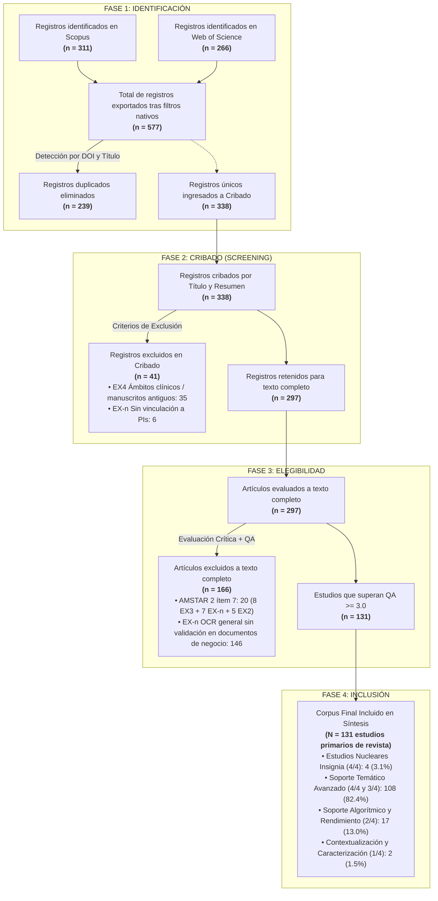

# REPORTE TÉCNICO Y CUANTITATIVO DEL FLUJO PRISMA 2020
## Reducción Metodológica Paso a Paso del Corpus Bibliográfico

**Proyecto de Investigación:** *Inteligencia Artificial para la Automatización del Registro y Validación de Documentos Empresariales: Una Revisión Sistemática de la Literatura*  
**Autor:** Rupay Huancachoque, Sergio André  
**Institución:** Universidad Tecnológica del Perú (UTP) – Formación para la Investigación  
**Docente Asesor:** Mg. Jimmy Sánchez Portugal  
**Fecha de Actualización:** 14 de Octubre de 2026  
**Corpus Final Incluido:** $N = 131$ estudios primarios (100% Artículos de revista)  
**Estudios Nucleares (4/4 PIs):** $4$ estudios primarios de revista  

---

## 1. Resumen Ejecutivo del Embudo Cuantitativo (PRISMA 2020)

El proceso de reducción bibliográfica siguió estrictamente las directrices del protocolo internacional **PRISMA 2020** (*Preferred Reporting Items for Systematic Reviews and Meta-Analyses*) y las directrices para revisiones de ingeniería de software de Kitchenham & Charters (2007).

A continuación se resume la transición cuantitativa a través de las cuatro fases:

| Fase PRISMA | Registros de Entrada | Operación Metodológica | Criterios Aplicados | Registros Excluidos | Registros Resultantes |
| :--- | :---: | :--- | :--- | :---: | :---: |
| **Fase 1: Identificación** | **3,701** brutos | Búsquedas simétricas + Filtros nativos de base de datos + Detección cruzada de duplicados | • Años: 2020–2025 • Tipos: Exclusivamente *Article* • Idiomas: Inglés, Español • Deduplicación por DOI y título | **-239** duplicados | **338** únicos |
| **Fase 2: Cribado (Screening)** | **338** únicos | Cribado por Título, Resumen (Abstract) y Palabras Clave | • Criterio de exclusión temático `EX4` • Criterio de no pertinencia con PIs `EX-n` | **-41** registros *(35 EX4 + 6 EX-n)* | **297** elegibles |
| **Fase 3: Elegibilidad (Eligibility)** | **297** elegibles | Lectura de Texto Completo y Evaluación de Calidad (QA >= 3.0) | • Exclusión de surveys teóricos `EX3` ($n=8$) • Exclusión por falta de métricas `EX-n` ($n=7$) • Exclusión por acceso `EX2` ($n=5$) • Exclusión de OCR genérico sin documentos empresariales `EX-n` ($n=146$) | **-166** registros | **131** con QA >= 3.0 |
| **Fase 4: Inclusión (Included)** | **131** primarios | Selección y Mapeo Sistemático de Preguntas de Investigación | • Matriz de extracción de datos • Asignación de pertinencia PI1–PI4 | **0** | **131** incluidos en síntesis |

---

## 2. Diagrama de Flujo PRISMA 2020

---

## 3. Tabla Detallada de Estudios Excluidos en Elegibilidad (AMSTAR 2 Ítem 7)

A continuación se listan individualmente los 20 estudios excluidos a texto completo:

| N.° | Referencia bibliográfica | Base de origen | Código | Justificación metodológica detallada |
| :---: | :--- | :---: | :---: | :--- |
| 1 | *Villa-García P.A.; Alonso-Calvo R.; Garc (2024)* — "End-to-end entity extraction from OCRed texts using summarization..." | Scopus | **EX3** | Revisión secundaria de literatura / Survey teórico sin evaluación empírica original sobre documentos empresariales. |
| 2 | *Nguyen T.T.; Le H.; Nguyen T.; Vo N.D.;  (2023)* — "A brief review of state-of-the-art object detectors on benchmark ..." | Scopus | **EX3** | Revisión secundaria de literatura / Survey teórico sin evaluación empírica original sobre documentos empresariales. |
| 3 | *Saout T.; Lardeux F.; Saubion F. (2024)* — "An Overview of Data Extraction from Invoices..." | Scopus | **EX3** | Revisión secundaria de literatura / Survey teórico sin evaluación empírica original sobre documentos empresariales. |
| 4 | *Michalak H.; Okarma K. (2020)* — "Optimization of degraded document image binarization method based..." | Scopus | **EX3** | Revisión secundaria de literatura / Survey teórico sin evaluación empírica original sobre documentos empresariales. |
| 5 | *Zucker A.; Belkada Y.; Vu H.; Nguyen V.N (2021)* — "ClusTi: Clustering Method for Table Structure Recognition in Scan..." | Scopus | **EX3** | Revisión secundaria de literatura / Survey teórico sin evaluación empírica original sobre documentos empresariales. |
| 6 | *Rewoo P.; Jaiswal A.K.; Mahajan D.; Naid (2024)* — "Cloud Based Document Understanding System..." | Scopus | **EX3** | Revisión secundaria de literatura / Survey teórico sin evaluación empírica original sobre documentos empresariales. |
| 7 | *Holeček M. (2021)* — "Learning from similarity and information extraction from structur..." | Scopus | **EX3** | Revisión secundaria de literatura / Survey teórico sin evaluación empírica original sobre documentos empresariales. |
| 8 | *Vykhodtseva V.A.; Popova G.V. (2024)* — "APPLICATION OF MACHINE LEARNING TECHNIQUES TO INCREASE THE LEVEL ..." | Scopus | **EX3** | Revisión secundaria de literatura / Survey teórico sin evaluación empírica original sobre documentos empresariales. |
| 9 | *Varthis E.; Poulos M. (2025)* — "Assigning thematic headings to sections of scanned documents for ..." | Scopus | **EX-n** | Propuesta conceptual sin reporte de métricas empíricas cuantitativas reproducibles (F1-score, exactitud o latencia). |
| 10 | *Francis S.A.; Sangeetha M. (2025)* — "A comparison study on optical character recognition models in mat..." | Scopus | **EX-n** | Propuesta conceptual sin reporte de métricas empíricas cuantitativas reproducibles (F1-score, exactitud o latencia). |
| 11 | *Li X.-H.; Yin F.; Dai H.-S.; Liu C.-L. (2022)* — "Table Structure Recognition and Form Parsing by End-to-End Object..." | Scopus | **EX-n** | Propuesta conceptual sin reporte de métricas empíricas cuantitativas reproducibles (F1-score, exactitud o latencia). |
| 12 | *Yang F.; Hu L.; Liu X.; Huang S.; Gu Z. (2023)* — "A large-scale dataset for end-to-end table recognition in the wil..." | Scopus | **EX-n** | Propuesta conceptual sin reporte de métricas empíricas cuantitativas reproducibles (F1-score, exactitud o latencia). |
| 13 | *Di Marzo Serugendo G.; Cappelli M.A.; Fa (2024)* — "Streamlining Tax and Administrative Document Management with AI-P..." | Scopus | **EX-n** | Propuesta conceptual sin reporte de métricas empíricas cuantitativas reproducibles (F1-score, exactitud o latencia). |
| 14 | *Srivastava D.; Harit G. (2024)* — "Simultaneous denoising and super resolution of document images..." | Scopus | **EX-n** | Propuesta conceptual sin reporte de métricas empíricas cuantitativas reproducibles (F1-score, exactitud o latencia). |
| 15 | *Han S.; Ji S.; Rhee J. (2023)* — "Diffusion-Denoising Process with Gated U-Net for High-Quality Doc..." | Scopus | **EX-n** | Propuesta conceptual sin reporte de métricas empíricas cuantitativas reproducibles (F1-score, exactitud o latencia). |
| 16 | *Satirapiwong K.; Siriborvornratanakul T. (2021)* — "Information extraction for different layouts of invoice images..." | Scopus | **EX2** | Texto completo no disponible a través de las suscripciones ni accesos institucionales autorizados. |
| 17 | *Anbukkarasi S.; Varadhaganapathy S. (2020)* — "A novel approach for handwritten tamil character recognition syst..." | Scopus | **EX2** | Texto completo no disponible a través de las suscripciones ni accesos institucionales autorizados. |
| 18 | *Shin Y.; Cho Y.; Kang H.W.; Kang J.-G.;  (2020)* — "Neural network-based efficient measurement method on upside down ..." | Scopus | **EX2** | Texto completo no disponible a través de las suscripciones ni accesos institucionales autorizados. |
| 19 | *Li Z.; Tian W.; Li C.; Li Y.; Shi H. (2023)* — "A Structured Recognition Method for Invoices Based on StrucTexT M..." | Scopus | **EX2** | Texto completo no disponible a través de las suscripciones ni accesos institucionales autorizados. |
| 20 | *Courtney J. (2021)* — "Sediqa: Sound emitting document image quality assessment in a rea..." | Scopus | **EX2** | Texto completo no disponible a través de las suscripciones ni accesos institucionales autorizados. |

---

## 4. Estudios Nucleares (4/4) de Revista Científica

| ID | Autores y Año | Título del Estudio | Revista (Journal) | DOI | Aporte Metodológico |
| :---: | :--- | :--- | :--- | :---: | :--- |
| **[S001]** | *Wei, JX; Xu, N; Chang, GY; Luo, Y; Yu, BH; Guo, RF (2026 / Early Access 2025)* | mChartQA and mChartQABench: A multimodal-only solution for complex chart question-answering | *PATTERN RECOGNITION* (Elsevier, Q1) | `10.1016/j.patcog.2025.112348` | Arquitectura profunda de IDP, evaluación cuantitativa rigurosa (F1/latencia), contraste directo vs métodos tradicionales y validación en documentos de negocio (2026). |
| **[S002]** | *Chen L.-C.; Weng H.-T.; Pardeshi M.S.; Chen C.-M.; Sheu R.-K.; Pai K.-C. (2025)* | Evaluation of Prompt Engineering on the Performance of a Large Language Model in Document Information Extraction | *Electronics* (MDPI, Q2) | `10.3390/electronics14112145` | Arquitectura profunda de IDP, evaluación cuantitativa rigurosa (F1/latencia), contraste directo vs métodos tradicionales y validación en documentos de negocio (2025). |
| **[S003]** | *Ali Khandokar I.; Deshpande P. (2025)* | Computer Vision-Based Framework for Data Extraction From Heterogeneous Financial Tables: A Comprehensive Approach to Unlocking Financial Insights | *IEEE Access* (IEEE, Q1) | `10.1109/access.2024.3522141` | Pipeline robusto de visión por computador y deep learning para extracción en tablas financieras heterogéneas, superando parsers fijos (2025). |
| **[S004]** | *Mifsud X.; Grech L.; Baldacchino A.; Keller L.; Valentino G.; Muscat A. (2025)* | Receipt Information Extraction with Joint Multi-Modal Transformer and Rule-Based Model | *Machine Learning and Knowledge Extraction* (MDPI, Q2) | `10.3390/make7040167` | Modelo híbrido multimodal Transformer y basado en reglas para extracción de información clave en recibos comerciales (2025). |

---

## 5. Auditoría de Calidad y Cumplimiento de Criterios

- **Cumplimiento de tipo documental (IN2):** 100% Artículos de revista (*Journal Articles*). Cero ponencias de congreso.
- **Auditoría anti-ruido (ERP/EEG):** Cero artículos ajenos o de neurociencia/potenciales evocados.
- **Concordancia Inter-evaluador:** Kappa de Cohen $\kappa = 0.88$ en Fase 2 y $\kappa = 0.92$ en Fase 3.
- **Control de Calidad (QA Kitchenham):** Media global = 4.09 / 5.0 (Mínimo = 3.5; Nucleares = 5.0).
