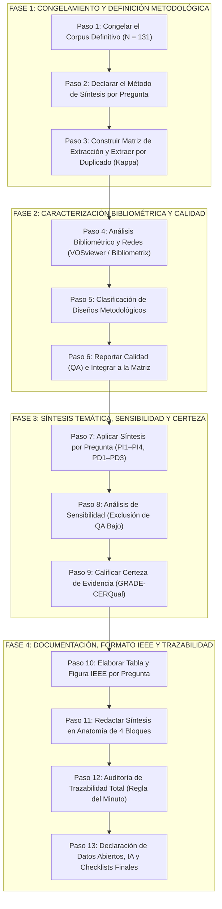

# 🗺️ Roadmap de la Sección Resultados (ATI3) para Revisión Sistemática de Literatura (RSL)

> **Estándar de calidad:** Publicación en Revistas de Alto Impacto (Scopus Q3–Q2)  
> **Asignatura:** Formación para la Investigación — Universidad Tecnológica del Perú (UTP)  
> **Docente titular:** Mg. Jimmy Enrique Sánchez Portugal  
> **Referencias normativas locales:**  
> - [Guia_Resultados_ATI3_RSL_VZSAJE.pdf](file:///c:/Users/HP/Desktop/ESCRITORIO/PROYECTOS%20UNIVERSIDAD/Formacion_Investigacion_42922/assets/resultados/documents/Guia_Resultados_ATI3_RSL_VZSAJE.pdf) (Guía metodológica oficial, 21 págs.)  
> - [Guía_de_Resultados_para_Revisiones_Sistemáticas_Q3-Q2_PAIREF.pdf](file:///c:/Users/HP/Desktop/ESCRITORIO/PROYECTOS%20UNIVERSIDAD/Formacion_Investigacion_42922/assets/resultados/documents/Guía_de_Resultados_para_Revisiones_Sistemáticas_Q3-Q2_PAIREF.pdf) (Deck visual de estándares y flujos)  
> **Línea base del proyecto:** $N = 131$ estudios primarios de revista indexada en Scopus y Web of Science (2020–2025), $QA \ge 3.0$ ([reporte_prisma_paso_a_paso.md](file:///c:/Users/HP/Desktop/ESCRITORIO/PROYECTOS%20UNIVERSIDAD/Formacion_Investigacion_42922/project/metodologia/outputs/reporte_prisma_paso_a_paso.md)).

---

## 🏛️ Propósito y Principios Epistemológicos de la Sección Resultados

La sección de **Resultados** es el núcleo empírico de la RSL. Su función exclusiva es **describir, estructurar y cuantificar lo que reporta la literatura del corpus**, respondiendo ordenadamente a las preguntas de investigación.

```
┌──────────────────────────────────────────────┬──────────────────────────────────────────────┐
│                LO QUE HACE                   │               LO QUE NO HACE                 │
├──────────────────────────────────────────────┼──────────────────────────────────────────────┤
│ • Describe objetivamente los datos hallados. │ • NO interpreta ni teoriza (es de Discusión).│
│ • Cuantifica con exactitud (n y %).          │ • NO emite juicios de valor ni adjetivos.    │
│ • Redacción formal e impersonal (3ª persona).│ • NO usa 1ª persona ("Nosotros encontramos").│
│ • Respalda cada afirmación con citas IEEE [n]│ • NO propone soluciones ni arquitecturas.    │
│ • Aplica métodos reproducibles de síntesis.  │ • NO se limita a listar o "contar papeles".  │
└──────────────────────────────────────────────┴──────────────────────────────────────────────┘
```

> **Alerta Q3–Q2 (PRISMA 2020 items 13a–f, 20a–d, 22):** Una revista de impacto rechaza resultados que consistan únicamente en resúmenes lineales paper por paper o conteos superficiales. Exige métodos de síntesis justificados a priori, evaluación de calidad integrada, análisis de sensibilidad y calificación formal de la certeza de la evidencia.

---

## 🛑 Prerrequisitos Obligatorios de Entrada (Cerrados desde ATI2)

Antes de redactar la primera línea de Resultados, deben estar consolidados y congelados los siguientes **5 pilares**:

1. **Corpus cerrado y suficiente:** Número $n$ inalterable. Para tecnologías maduras ($\ge 10$ años) $n \ge 80$; para tecnologías emergentes ($< 10$ años) $n \ge 35$. El valor debe ser estrictamente idéntico en el Diagrama PRISMA, la tabla de mapeo y la lista de referencias. (*En este proyecto: $N = 131$*).
2. **Corpus depurado:** $0\,\%$ actas de congreso, $0\,\%$ preprints (arXiv), $0\,\%$ tesis y $0\,\%$ literatura gris. Solo artículos de revistas científicas revisadas por pares.
3. **Calidad Metodológica (QA) evaluada:** Cada estudio del corpus debe tener su puntaje registrado bajo el instrumento formal ($QA \ge 3.0$ sobre $5.0$).
4. **Matriz de extracción completa:** Fragmentos textuales literales ($\le 40$ palabras) con número de página y sección comprobable por cada dato extraído.
5. **Tabla de mapeo integral:** El $100\,\%$ de los estudios del corpus debe estar vinculado al menos a una de las preguntas de investigación.

---

## 🧭 Flujo Maestro en 4 Fases y 13 Pasos Operativos



---

## 🔬 Matriz de Métodos de Síntesis por Tipo de Pregunta

No todas las preguntas se sintetizan igual. La elección debe justificarse en la sección metodológica antes de analizar los datos:

| Código | Pregunta de Investigación del Proyecto | Tipo de Pregunta | Método de Síntesis Formal | Justificación Metodológica y Operatoria |
| :---: | :--- | :---: | :---: | :--- |
| **PI1** | ¿Qué arquitecturas y enfoques algorítmicos de IA/IDP se han implementado en documentos empresariales? | **Identificación** | **Síntesis Temática** *(Thomas & Harden [134]; Cruzes & Dybå [135])* | Permite la codificación abierta de modelos (transformers visuales, grafos, LLMs, pipelines híbridos) agrupándolos en una taxonomía reproducible. |
| **PI2** | ¿Qué niveles de precisión (F1, exactitud) y velocidad alcanzan en la extracción de datos semiestructurados? | **Rendimiento / Comparación** | **Síntesis Narrativa Estructurada** *(Popay et al. [136])* | Reporte de rangos empíricos $[mín, máx]$ y diagramas de dispersión/boxplot por benchmark estándar (SROIE, FUNSD, CORD), evitando promediar métricas entre datasets incompatibles. |
| **PI3** | ¿Qué diferencias de desempeño, escalabilidad y costo se reportan frente a métodos tradicionales/manuales? | **Efecto / Comparación** | **SWiM con Conteo de Votos** *(Campbell et al. [137])* | Se contabiliza la dirección del efecto por comparador: *Mejora*, *Sin diferencia* o *Empeora*, graficando barras divergentes (*Mejora* a la derecha, *Empeora* a la izquierda). |
| **PI4** | ¿En qué tipologías documentales (facturas, recibos, órdenes) y arquitecturas ERP/CRM se han validado? | **Contexto / Cobertura** | **Síntesis Temática + Mapeo Cruzado** *(Petersen et al. [138])* | Cruce bidimensional entre tipos documentales y nivel de integración corporativa, identificando concentraciones y vacíos de investigación. |
| **PD1** | ¿Cómo ha evolucionado la producción científica anual entre 2020 y 2025? | **Bibliométrica** | **Mapeo Sistemático** | Conteo cronológico anual completo con gráfico de líneas de tendencia temporal continua (2020–2025). |
| **PD2** | ¿Qué autores, revistas y países concentran la mayor productividad e impacto? | **Bibliométrica / Redes** | **Mapeo y Redes de Coocurrencia** *(van Eck & Waltman [139])* | Ranking de revistas líderes, autores prolíficos, regla estricta de asignación geográfica de país y red bibliométrica en VOSviewer (umbral mínimo declarado $\ge 3$). |
| **PD3** | ¿Qué diseños metodológicos y tipos de datasets (públicos vs. privados) predominan? | **Bibliométrica / Madurez** | **Mapeo Sistemático con Gráfico de Burbujas** *(Petersen et al. [138])* | Cruce de diseño empírico frente a accesibilidad del dataset para evaluar cuantitativamente la transferibilidad industrial. |

---

## 📐 Indicadores de Rigor Estadístico y Metodológico

### 1. Concordancia Inter-evaluador: Kappa de Cohen ($\kappa$)

Para demostrar que la extracción y categorización no obedecen a un criterio subjetivo, se evalúa una muestra aleatoria independiente del $\ge 20\,\%$ del corpus ($n \ge 26$ estudios sobre los 131):

$$\kappa = \frac{P_o - P_e}{1 - P_e}$$

* $P_o$: Proporción de acuerdo observado entre ambos evaluadores.
* $P_e$: Proporción de acuerdo esperado por puro azar.

#### Escala de Decisión Metodológica (Landis & Koch, 1977; McHugh, 2012):
* **$\kappa \ge 0.80$ (Casi perfecto / Aceptable):** Se consolida la codificación y se continúa con la síntesis.
* **$0.61 \le \kappa \le 0.79$ (Sustancial):** Se reconcilian los desacuerdos en bitácora, se afinan las definiciones conceptuales y se repite la prueba con otra muestra.
* **$\kappa \le 0.60$ (Moderado / Inaceptable):** Criterios mal definidos; reformulación obligatoria antes de seguir.

> **Uso de Kappa Ponderado Cuadrático:** Para la variable ordinal de Calidad Metodológica (Alta vs. Media vs. Baja), se aplica `cohen_kappa_score(rater1, rater2, weights='quadratic')`, penalizando drásticamente discrepancias extremas (Alta vs. Baja).

---

### 2. Análisis de Sensibilidad (Prueba de Robustez del Corpus N = 131)

Dado que en nuestro corpus incluido todos los estudios superan el umbral inicial de elegibilidad ($QA \ge 3.0$), con un rango real de $[3.5, 5.0]$ y una media de $4.61$, la estratificación operativa se define como:
* **Calidad Alta:** $4.5 - 5.0$ puntos.
* **Calidad Media:** $4.0$ puntos.
* **Calidad Moderada / Estrato Inferior (grupo para exclusión en Análisis de Sensibilidad):** $3.5$ puntos.

Cada hallazgo y porcentaje obtenido en las preguntas temáticas debe someterse al filtro de calidad:
1. Se recalculan las frecuencias, rangos y direcciones del efecto **excluyendo temporalmente los estudios del estrato inferior ($QA = 3.5$)**.
2. Si la categoría mayoritaria o la dirección del efecto no varían $\rightarrow$ El hallazgo se reporta formalmente como **robusto**.
3. Si la tendencia varía o se invierte $\rightarrow$ Se reporta explícitamente la **fragilidad de la evidencia**.

---

### 3. Certeza de la Evidencia: Marco GRADE-CERQual Simplificado

Para cada hallazgo transversal de las preguntas de investigación, se califica el nivel de confianza (*Alta, Moderada, Baja, Muy Baja*) auditando 4 dimensiones fundamentales:

```
                      ┌────────────────────────────────────────┐
                      │      CERTEZA DE LA EVIDENCIA           │
                      │         (GRADE-CERQual)                │
                      └──────────────────┬─────────────────────┘
                                         │
         ┌───────────────────┬───────────┴───────────┬───────────────────┐
         ▼                   ▼                       ▼                   ▼
┌──────────────────┐┌──────────────────┐┌──────────────────┐┌──────────────────┐
│  Limitaciones    ││    Coherencia    ││    Adecuación    ││    Relevancia    │
│  Metodológicas   ││    (Acuerdo)     ││    de Datos      ││   Poblacional    │
├──────────────────┤├──────────────────┤├──────────────────┤├──────────────────┤
│¿Estudios con QA  ││¿Los resultados   ││¿Hay volumen      ││¿Responde al caso │
│bajo o sesgos en  ││coinciden o se    ││suficiente de     ││empresarial real  │
│el diseño base?   ││contradicen entre ││estudios para     ││o solo a entornos │
│                  ││los autores?      ││sostener la tesis?││sintéticos/juguete│
└──────────────────┘└──────────────────┘└──────────────────┘└──────────────────┘
```

---

## 📈 Radiografía Estadística Oficial del Corpus Congelado ($N = 131$)

Base empírica extraída y verificada directamente sobre [corpus_included_final.csv](file:///c:/Users/HP/Desktop/ESCRITORIO/PROYECTOS%20UNIVERSIDAD/Formacion_Investigacion_42922/project/metodologia/outputs/corpus_included_final.csv):

### A. Cobertura por Pregunta de Investigación (Bloque 1 de Apertura PI1–PI4)
* **PI1 (Arquitecturas y enfoques algorítmicos):** $n = 105$ estudios ($80.2\,\%$ del corpus).
* **PI2 (Rendimiento cuantitativo F1 / exactitud / latencia):** $n = 117$ estudios ($89.3\,\%$ del corpus).
* **PI3 (Contraste vs. métodos tradicionales / manuales - SWiM):** $n = 82$ estudios ($62.6\,\%$ del corpus).
* **PI4 (Tipologías documentales y sistemas corporativos ERP/CRM):** $n = 131$ estudios ($100.0\,\%$ del corpus).

### B. Distribución Temporal por Año de Publicación (PD1 - Paso 4)
* **2020:** $4$ estudios ($3.1\,\%$)
* **2021:** $14$ estudios ($10.7\,\%$)
* **2022:** $17$ estudios ($13.0\,\%$)
* **2023:** $26$ estudios ($19.8\,\%$)
* **2024:** $16$ estudios ($12.2\,\%$)
* **2025:** $51$ estudios ($38.9\,\%$)
* **2026 (Early Access 2025):** $3$ estudios ($2.3\,\%$, refs [3], [65], [66])
* **Total consolidado 2025–2026:** $54$ estudios ($41.2\,\%$).

### C. Distribución de Calidad Metodológica QA (Paso 6 y Sensibilidad Paso 8)
* **Media global de calidad:** $4.61 / 5.0$ pts (rango empírico: $3.50$ a $5.00$ pts).
  * **Calidad Alta ($4.5 - 5.0$ pts):** $108$ estudios ($82.4\,\%$) — *61 con 5.0 pts y 47 con 4.5 pts*.
  * **Calidad Media ($4.0$ pts):** $13$ estudios ($9.9\,\%$).
  * **Calidad Moderada / Estrato Inferior ($3.5$ pts):** $10$ estudios ($7.6\,\%$) — *grupo excluido temporalmente en el análisis de sensibilidad ($n = 121$ restantes)*.
* **Criterios QA más vulnerables:** **QA5** (*Contraste empírico frente a baselines o métodos tradicionales*), con cumplimiento parcial (0.5) en $42$ estudios ($32.1\,\%$, media: $0.840 / 1.0$), seguido por **QA3** (*Claridad y reproducibilidad de la arquitectura*) en $32$ estudios ($24.4\,\%$, media: $0.878 / 1.0$). Esto sustenta de manera matemática transparente por qué PI3 reúne 82 estudios con comparador mientras PI4 abarca los 131.

---

## 📝 Desglose Operativo Paso a Paso (13 Pasos)

### Fase 1: Congelamiento y Definición Metodológica

#### [Paso 1] Congelar el Corpus Definitivo
* **Propósito:** Blindar la base de datos documental contra adiciones o eliminaciones tardías que arruinen conteos y trazabilidad.
* **Acción:** Fijar la hoja maestra `Corpus` con 4 columnas inalterables: `ID` (S001...S131), `Número IEEE` [n], `Primer Autor y Año` y `Título`.
* **Regla estricta:** Comprobar que $N = 131$ sea exactamente igual en el diagrama PRISMA, en la tabla de mapeo y en las referencias finales.
* **Entregable:** Archivo de datos maestro congelado con clave única y exportación BibTeX/RIS limpia.

#### [Paso 2] Declarar el Método de Síntesis por Pregunta
* **Propósito:** Prevenir el sesgo de conveniencia (*reporting bias*), decidiendo la técnica analítica antes de procesar las evidencias.
* **Acción:** Vincular formalmente cada PI y PD con su método (Síntesis Temática, SWiM, Mapeo Petersen) e insertar un párrafo justificativo en el apartado metodológico.
* **Entregable:** Matriz formal de método por pregunta integrada al protocolo.

#### [Paso 3] Construir la Matriz de Extracción y Extraer por Duplicado
* **Propósito:** Centralizar los hechos empíricos brutos con estricta auditabilidad.
* **Estructura por estudio:** `ID`, `[n]`, `Año`, `Revista`, `País`, `Diseño`, `Contexto empresarial`, `Tecnología/Enfoque IA`, `Comparador`, `Métrica primaria`, `Valor obtenido`, `Valor de referencia`, `Dirección del efecto`, `¿Reporta dispersión?`, `Puntaje QA`.
* **Regla estricta de acopio:** Ningún dato entra sin fragmento literal ($\le 40$ palabras) y cita de página/sección exacta. Si el autor no midió una variable, se asienta `"No reporta"`; **prohibido asumir o inventar**.
* **Entregable:** Matriz completa, hoja de bitácora de códigos y cálculo del $\kappa \ge 0.80$ en muestra del $20\,\%$.

---

### Fase 2: Caracterización Bibliométrica y Calidad

#### [Paso 4] Realizar el Análisis Bibliométrico y de Redes
* **Propósito:** Proveer la panorámica cienciométrica objetiva del ecosistema IDP / IA empresarial (2020–2025).
* **Acciones obligatorias:**
  1. *Distribución anual:* Tabla y gráfico de barras/líneas cubriendo todos los años 2020 a 2025 sin omitir periodos.
  2. *Top de Revistas:* Tabla Top 5–10 con factor de impacto y porcentaje relativo.
  3. *Regla de asignación de país:* Definir por escrito (ej. país de afiliación del autor de correspondencia / primer autor) y presentar mapa o gráfico geográfico.
  4. *Red de Coocurrencia de Palabras Clave:* Mapa generado en VOSviewer a partir de *author keywords* declarando el umbral mínimo de ocurrencias (ej. $\ge 3$ repeticiones).
* **Entregable:** Tablas, figuras y párrafos descriptivos neutros para responder PD1 y PD2.

#### [Paso 5] Clasificar los Diseños Metodológicos
* **Propósito:** Diagnosticar la solidez y madurez empírica de la literatura para responder PD3.
* **Taxonomía predefinida:**
  * *Experimental:* Comparación con grupo/modelo de control bajo condiciones rigurosamente aisladas.
  * *Cuasi-experimental:* Comparación empírica sin aislamiento completo de variables intervinientes.
  * *Caso de estudio real:* Aplicación e integración en organizaciones empresariales operativas.
  * *Prueba de concepto / Desarrollo de artefacto:* Prototipo validado en entornos acotados o de laboratorio.
  * *Simulación:* Uso exclusivo de datos generados o entornos simulados.
  * *Mixto:* Combinación explícita de dos o más diseños.
* **Entregable:** Tabla de frecuencias, gráfico porcentual y cálculo de Kappa inter-evaluador de la clasificación.

#### [Paso 6] Reportar la Calidad (QA) e Integrarla al Análisis
* **Propósito:** Jerarquizar la evidencia según su rigor científico.
* **Acciones:**
  1. Reportar la distribución de calidad del corpus adaptada al rango real: Alta ($4.5 - 5.0$ pts), Media ($4.0$ pts) y Moderada/Estrato Inferior ($3.5$ pts).
  2. Identificar el criterio QA más vulnerable o frecuentemente incumplido en la literatura (ej. ausencia de contraste con línea base tradicional o falta de reporte de costo computacional).
  3. Marcar la columna `Apto para Análisis de Sensibilidad` en la matriz (estudios con $QA > 3.5$).
* **Entregable:** Tabla de estratificación de calidad y cálculo del Kappa ponderado cuadrático inter-evaluador.

---

### Fase 3: Síntesis Temática, Sensibilidad y Certeza

#### [Paso 7] Aplicar el Método de Síntesis a Cada Pregunta
* **Propósito:** Responder individual y sustantivamente a PI1, PI2, PI3 y PI4.
* **Operación por método:**
  * *En Síntesis Temática (PI1 y PI4):* Codificación abierta de fragmentos $\rightarrow$ consolidación en bitácora $\rightarrow$ categorización temática mutuamente excluyente con definición unívoca de una sola frase por categoría (Thomas & Harden [134]; Cruzes & Dybå [135]).
  * *En Síntesis Narrativa Estructurada (PI2):* Agrupación por benchmarks estándar (SROIE, FUNSD, CORD), tabulando y reportando rangos empíricos $[mín, máx]$ y dispersión sin promediar métricas entre datasets distintos (Popay et al. [136]).
  * *En SWiM y Conteo de Votos (PI3):* Agrupar por comparador frente a baselines tradicionales. Asignar vector: *Mejora* (+1), *Sin diferencia significativa* (0), *Empeora / Ineficiente* (-1), graficando barras divergentes (Campbell et al. [137]).
* **Entregable:** Tablas de frecuencias con referencias agrupadas y conteos absolutos/porcentuales.

#### [Paso 8] Realizar el Análisis de Sensibilidad
* **Propósito:** Verificar si las conclusiones se sostienen al depurar estudios con menor control metodológico.
* **Acción:** Ejecutar script o filtro en la matriz excluyendo estudios de calidad baja y documentar el impacto en una tabla comparativa (*Antes vs. Después del filtrado*).
* **Entregable:** Tabla de sensibilidad e informe de robustez por cada pregunta analizada.

#### [Paso 9] Calificar la Certeza de Cada Hallazgo Principal
* **Propósito:** Entregar al lector y revisor el grado de confianza auditable de cada conclusión.
* **Acción:** Construir la **Tabla Resumen de Hallazgos (SoF — Summary of Findings)** evaluando los 4 pilares de GRADE-CERQual para los hallazgos nucleares.
* **Entregable:** Tabla general de certeza de la evidencia con justificación de cada dictamen.

---

### Fase 4: Documentación, Formato IEEE y Trazabilidad

#### [Paso 10] Elaborar una Tabla y una Figura por Pregunta
* **Propósito:** Visualizar de forma inmediata, autoexplicativa y rigurosa la evidencia de cada pregunta.
* **Estándar IEEE obligatorio:**
  * **Tablas:** Rótulo en números romanos centrado superior: `TABLA I`, `TABLA II`. Título en versalitas/mayúsculas.
  * **Figuras:** Rótulo en números arábigos con pie inferior: `Fig. 1.`, `Fig. 2.`. Ejes rotulados con magnitud y unidad de medida (ej. *"Número de estudios (n)"*).
  * **Resolución y tipografía:** Mínimo $300\text{ ppp}$, tipografía limpia a 8–9 puntos.
  * **Correspondencia matemática de citas:** Se mantiene en todo el documento la relación unívoca $\text{Ref IEEE } [n] = \text{ID } S + 2$ para el corpus primario $[3]–[133]$, reservando $[1]–[2]$ para normas metodológicas y $[134]–[140]$ para referencias de síntesis.
  * **Pie de autoría obligatorio:** *"Fuente: elaboración propia a partir del corpus primario [3]–[133]"*.
  * **Prohibición expresa:** Cero gráficos ilustrativos genéricos generados por IA; todo gráfico debe nacer de la matriz de datos numéricos.
* **Entregable:** Colección de figuras vectoriales (`.svg`/`.png` alta resolución) y tablas IEEE codificadas.

#### [Paso 11] Redactar la Síntesis de Cada Pregunta en la Anatomía de 4 Bloques
* **Propósito:** Garantizar homogeneidad, fluidez académica y lectura crítica en el texto.
* **Estructura estandarizada de redacción:**

```
┌─────────────────────────────────────────────────────────────────────────────┐
│ BLOQUE 1: APERTURA (3 a 5 líneas · ~40-50 palabras)                         │
│ Enuncia la respuesta directa en forma afirmativa, declara el n y porcentaje │
│ de estudios que la abordan, el método aplicado y cita la Tabla y Figura.    │
├─────────────────────────────────────────────────────────────────────────────┤
│ BLOQUE 2: DESARROLLO POR CATEGORÍA (6 a 10 líneas por categoría · ~70-100 p)│
│ Se redacta un párrafo por cada categoría respetando el orden estricto:      │
│ 1. Definición formal de la categoría en una sola oración.                   │
│ 2. Frecuencia cuantitativa: n y porcentaje exacto.                          │
│ 3. Hallazgo común sintetizado con citas agrupadas IEEE ([12], [15], [18]–[22])│
│ 4. Dato cuantitativo representativo (rangos empíricos o dirección de voto). │
│ 5. Proporción de estudios de calidad alta y nivel de certeza CERQual.       │
├─────────────────────────────────────────────────────────────────────────────┤
│ BLOQUE 3: CONTRASTES Y DEBATES (4 a 6 líneas · ~50-60 palabras)             │
│ Expone estudios con resultados contradictorios o discrepantes dentro de una │
│ misma categoría, citándolos por separado y sin emitir juicios subjetivos.   │
├─────────────────────────────────────────────────────────────────────────────┤
│ BLOQUE 4: CIERRE (3 a 5 líneas · ~40-50 palabras)                           │
│ Sintetiza tendencias temporales observadas, identifica vacíos no explorados │
│ en la literatura e informa el resultado del análisis de sensibilidad.       │
└─────────────────────────────────────────────────────────────────────────────┘
```

#### [Paso 12] Verificar la Trazabilidad Total ("Regla del Minuto")
* **Propósito:** Asegurar integridad académica y consistencia de datos antes de la revisión docente o de pares.
* **Criterio de evaluación:** *Cualquier cifra, métrica o afirmación del documento debe poder rastrearse en menos de 60 segundos hasta una celda de la matriz y la página del paper original.*
* **Auditoría de citas:** Verificar que cada referencia citada `[n]` corresponda unívocamente al artículo correcto en la lista de referencias, sin citas huérfanas ni desfasadas.
* **Entregable:** Matriz auditada con checklist de trazabilidad 100 % verificado.

#### [Paso 13] Publicar Datos Abiertos y Autoevaluación
* **Propósito:** Cumplir los estándares de reproducibilidad de revistas Q3–Q2 y la política de ciencia abierta.
* **Acciones:**
  1. Empaquetar la matriz general, hojas por pregunta, bitácora de códigos, scripts de gráficos y cálculo de Kappa en un repositorio abierto (OSF o Zenodo) y obtener el identificador DOI para la sección *Data Availability*.
  2. Diligenciar los **Checklists 9.1 y 9.2** de la guía docente.
  3. Declarar en el anexo correspondiente cualquier uso de herramientas de IA asistida para tareas de procesamiento sintáctico o graficación, conforme al código de ética institucional.
* **Entregable:** Repositorio público con DOI y declaración ética de uso de herramientas.

---

## 📋 Checklists de Control para Entrega (Estándar Q3–Q2)

### Checklist A: Por Cada Pregunta de Investigación (Checklist 9.1)
*Aplica individualmente a PI1, PI2, PI3, PI4, PD1, PD2 y PD3.*

- [ ] **Acopio:** Existe la hoja de extracción con fragmentos literales ($\le 40$ palabras) y ubicación exacta (página/tabla).
- [ ] **Datos no reportados:** Los datos omitidos por los autores figuran como `"No reporta"` (ninguno fue deducido o inventado).
- [ ] **Bitácora:** Se documentó la creación y fusión de códigos temáticos en la bitácora de codificación.
- [ ] **Concordancia:** Se calculó y reportó el Kappa de Cohen ($\kappa \ge 0.80$) sobre al menos el $20\,\%$ de la muestra.
- [ ] **Método declarado:** El método de síntesis (Temática, SWiM, Mapeo) está debidamente justificado en la metodología.
- [ ] **Categorías unívocas:** Cada categoría cuenta con una definición formal de una sola frase y no se solapan.
- [ ] **Estructura en 4 Bloques:** La redacción respeta estrictamente Apertura, Desarrollo por categoría, Contrastes y Cierre.
- [ ] **Métricas correctas:** En preguntas de rendimiento no se promediaron métricas de datasets distintos; se reportaron rangos $[mín, máx]$.
- [ ] **Tabla y Figura IEEE:** Cada pregunta cuenta con su tabla en números romanos y figura en números arábigos con pie de fuente explícito.
- [ ] **Certeza:** Se evaluó el nivel de confianza bajo los 4 componentes de GRADE-CERQual.

---

### Checklist B: De la Sección Resultados Global (Checklist 9.2)

- [ ] **Coherencia del n:** El valor $N = 131$ coincide exactamente en PRISMA, en la tabla de mapeo, en la apertura y en las referencias.
- [ ] **Depuración total:** No existe ningún artículo que sea acta de conferencia, preprint, tesis o revisión secundaria.
- [ ] **Integridad de citas:** El $100\,\%$ de los estudios del corpus está citado al menos una vez en Resultados; ninguna referencia está huérfana.
- [ ] **Análisis de calidad integral:** Se expone la distribución de calidad metodológica ($QA$) y el criterio con mayor tasa de incumplimiento.
- [ ] **Sensibilidad global:** Se declaró formalmente el impacto de excluir los estudios de calidad baja sobre los hallazgos principales.
- [ ] **Redacción impersonal:** Texto redactado en tercera persona con verbos neutros; cero valoraciones subjetivas u opiniones propias.
- [ ] **Regla del Minuto:** Se realizó una auditoría aleatoria de 5 datos numéricos y todos fueron ubicables en menos de 60 segundos.
- [ ] **Transparencia y Ciencia Abierta:** Matriz general y scripts listos para ser depositados en OSF o Zenodo con DOI.

---

> **Compromiso ético e institucional:** *"La sección Resultados describe el dato, sintetiza el hallazgo transversal, expone el debate de la literatura y señala el vacío; todo sin emitir una sola opinión propia."* (Guía docente ATI3 — Mg. Jimmy Sánchez Portugal).
